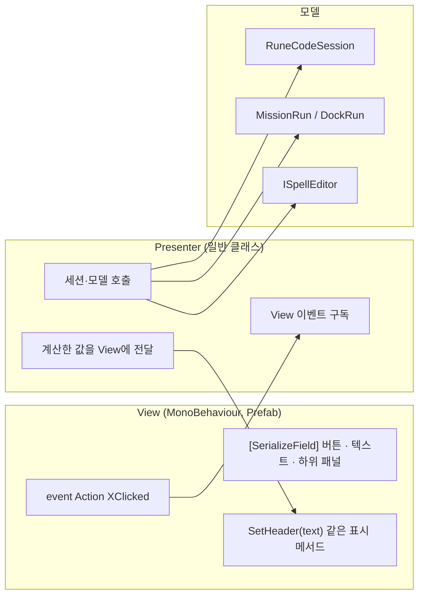
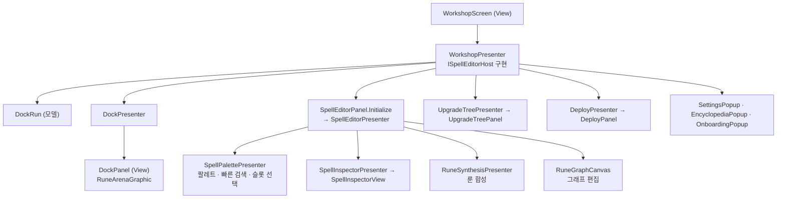
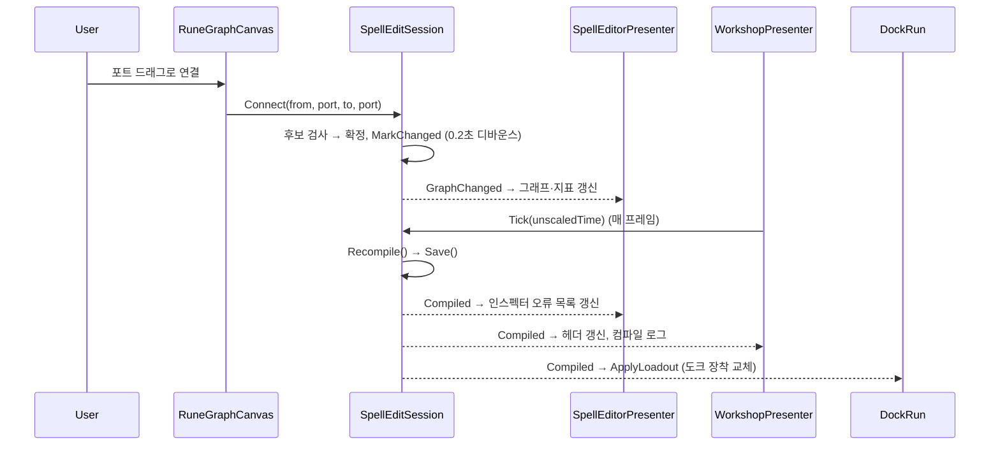
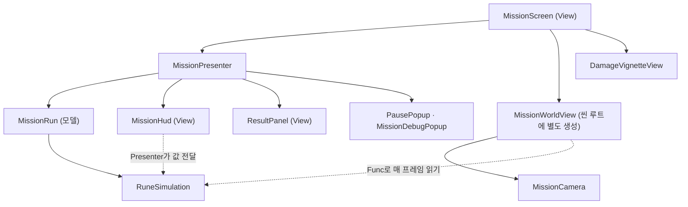

# 05. UI 구조와 연결

UI는 uGUI 기반이며 **UIManager가 층별 Canvas와 화면·팝업 수명을 관리**하고, 각 화면은 **View(MonoBehaviour) + Presenter(일반 C# 클래스)** 쌍으로 구성된다. 전투 월드는 UI Canvas 밖의 별도 월드 오브젝트(스프라이트 + 정사영 카메라)로 그린다.

---

## 1. UIManager (`UI/Framework/`)

`RuneCodeApp`이 부팅 시 `UIManager.Create(transform)`로 만들며 앱 종료까지 유지된다.

### 1.1 층(UiLayer)

| 층 | Canvas 정렬 순서 | 내용 |
|---|---|---|
| `Screen` | 0 | 화면 View(타이틀·작업실·미션). 한 번에 하나만 표시 |
| `Popup` | 100 | 팝업 스택. 위에 열린 팝업이 입력·Esc를 먼저 받는다 |
| `System` | 200 | 토스트(`ShowToast`, 3초 후 숨김). 입력을 막지 않는다 |

각 층은 Overlay Canvas이며 1280×720 논리 해상도 루트를 가진다.

### 1.2 View 로딩 규칙

```
Resources/RuneCode/UI/{View 타입 이름}.prefab
```

- `ShowScreen<T>()`와 `OpenPopup<T>()`는 타입 이름으로 Prefab을 찾아 **처음 한 번만 Instantiate**하고, 이후에는 같은 인스턴스를 숨김·재표시한다(`GetView<T>`).
- 따라서 **View 클래스 이름과 Prefab 파일 이름이 같아야 한다.** 이름을 바꾸면 런타임에 Prefab을 못 찾는다.
- 하위 행·카드처럼 반복되는 요소 Prefab은 `Resources/RuneCode/UI/Elements/`, 버튼·패널 스킨 SO는 `Resources/RuneCode/UI/Skins/`에 있다. 화면 Prefab의 직렬화 필드로 연결한다.

| API | 동작 |
|---|---|
| `ShowScreen<T>(prepare)` | 토스트 숨김 → 열린 팝업 전부 닫기 → 이전 화면 `Hide` → `prepare(view)` → `Show` |
| `OpenPopup<T>()` | 팝업을 스택 맨 위로 올리고 `Bind(this)` 후 `Show`. 내용은 반환된 팝업의 설정 메서드로 채운다 |
| `ClosePopup`, `CloseAllPopups` | 스택에서 제거하고 닫기 |
| `Confirm(title, message, label, onConfirm, isDestructive)` | 공용 확인 팝업(`ConfirmPopup`) |
| `Alert(title, message)` | 버튼 하나 알림 |
| `ShowToast(message)` | System 층 토스트 |
| `IsPopupOpen` | 화면 입력(조준·단축키·도크 클릭) 차단 판단에 쓴다 |

`UIManager.Update`는 Esc 입력을 맨 위 팝업의 `HandleEscape()`에, 팝업이 없으면 현재 화면의 `HandleEscape()`에 전달한다. 텍스트 입력 중(`UiFactory.IsTyping()`)이면 무시한다.

### 1.3 기반 클래스

| 클래스 | 역할 |
|---|---|
| `UiView` | `Show()`/`Hide()`, 표시 직후 `OnShown()`, 숨기기 직전 `OnHidden()`, `HandleEscape()` |
| `UiPopup : UiView` | 소유 UIManager 연결, 닫기 버튼, `Closed` 이벤트(닫힐 때 한 번 알리고 구독을 비움), Esc로 닫기 |
| `ViewPool<T>` | 목록 행 재사용 풀(`Get`, `ReleaseAll`) |
| `UiFactory` | 좌상단 기준 좌표로 uGUI 요소를 코드에서 만드는 헬퍼. `IsTyping()` 제공 |

---

## 2. MVP 패턴

모든 화면이 같은 패턴을 따른다.



| 규칙 | 내용 |
|---|---|
| View는 계산하지 않는다 | 버튼 클릭을 `event`로 알리고, Presenter가 넘긴 값을 그대로 표시한다 |
| Presenter는 Unity 컴포넌트를 만들지 않는다 | View의 메서드로만 화면을 바꾼다. 팝업은 `UIManager.OpenPopup`으로 연다 |
| 생성은 한 번 | 화면 View의 `Initialize(session, ui)`가 `_presenter != null`이면 무시한다. 화면이 재사용되므로 Presenter도 앱 수명 동안 하나다 |
| 진입·퇴장 | View의 `OnShown` → `presenter.Enter()`/`Begin()`, `OnHidden` → `presenter.Exit()`/`End()` |
| 프레임 갱신 | View의 `Update()`가 `presenter.Tick()`을 부른다 |
| 정리 | View의 `OnDestroy()`가 `presenter.Dispose()`를 불러 세션 이벤트 구독을 해제한다 |

---

## 3. 화면별 구성

### 3.1 타이틀

| 클래스 | 역할 |
|---|---|
| `TitleScreen` | 새로 하기·이어 하기·저장 관리·환경 설정·디버그 시작·종료 버튼 이벤트 |
| `TitlePresenter` | 시작은 `RuneCodeSession.StartGame(isDebug)`, 저장 관리는 `SaveSlotsPopup`, 종료는 앱 종료 |
| `SaveSlotsPopup` | 슬롯 3개 조회·선택·생성·삭제 (`SelectSaveSlot`, `CreateSaveSlot`, `DeleteSaveSlot`) |

`StartGame`은 세이브 선택·디버그 해금·온보딩 1단계 개방·편집 세션 재로드 후 `RequestScreen(AppScreen.Workshop)`을 호출한다.

### 3.2 작업실



| 영역 | View | Presenter | 하는 일 |
|---|---|---|---|
| 헤더·탭 | `WorkshopScreen` | `WorkshopPresenter` | 탭 2개(`editor`, `tree`) 전환, 출격 영역(`deploy`) 열기·돌아가기, 보유 스크랩·RAM 헤더, 상태 토스트, 도움말·설정, 온보딩 자동 안내 |
| 마법 편집 | `SpellEditorPanel` | `SpellEditorPresenter` | 제목·지표 줄, 도구줄(보관함·이름·저장·공유·Undo·Redo·정렬·복사·붙여넣기), 단축키 |
| 그래프 | `RuneGraphCanvas` (+`Graph/` 보조 클래스) | (Presenter 없이 `ISpellEditor`에 직접 명령) | 포인터 입력 해석: 연결, 노드 드래그, 화면 이동·확대, 영역 선택, 연결선 삭제, 슬롯 장착·해제 |
| 팔레트 | `SpellEditorPanel`의 목록 영역, `QuickPalettePopup` | `SpellPalettePresenter` | 분류·검색어로 행동·속성·모드 행 표시(남은/보유 수). 행동은 노드 배치, 속성·모드는 선택한 행동의 빈 슬롯에 장착 |
| 인스펙터 | `SpellInspectorView`, `SpellParameterRow` | `SpellInspectorPresenter` | 선택 노드의 파라미터 행·설명·삭제 버튼, 컴파일 오류·경고 목록 |
| 합성 | `SpellEditorPanel` 내부 | `RuneSynthesisPresenter` | 미사용 룬 3개 + 스크랩으로 상위 룬 합성. 열려 있는 동안 편집 잠금 |
| 시험 도크 | `DockPanel` (`RuneArenaGraphic`) | `DockPresenter` | 더미 수 순환(1~5), 시험·리셋·자동 발사·적응·배속(0.5/1/2) |
| 강화 트리 | `UpgradeTreePanel`, `UpgradeTreeNodeView` 등 | `UpgradeTreePresenter` | SO 노드 배치로 트리 생성, 상태 표시, 구매(`BuyUpgradeNode`) |
| 출격 | `DeployPanel` | `DeployPresenter` | 스테이지 이동(`SelectStage`), 출현 적 표시, 출격(`TryPrepareMission` 성공 시 `RequestScreen(Mission)`) |
| 팝업 | `SpellListPopup`, `RenamePopup`, `SharePopup`, `SettingsPopup`, `SoundSettingsPopup`, `EncyclopediaPopup`, `OnboardingPopup` | 각 Presenter가 열고 채움 | |

#### 그래프 편집 화면의 내부 분리 (`UI/SpellEditor/Graph/`)

| 클래스 | 책임 |
|---|---|
| `RuneGraphCanvas` | 입력 해석과 편집 명령 전달, 하위 객체 조립 |
| `GraphViewport` | 이동·확대 상태와 그래프 좌표 ↔ 캔버스 좌표 변환 |
| `GraphNodeLayout` | 노드 크기·포트 위치, 화면 좌표의 노드·포트·연결선 찾기 |
| `GraphPointerState` | 선택·실행 하이라이트·드래그 상태 |
| `GraphMeshPainter` / `GraphMeshLayer` | 배경 격자·연결선·노드·포트·미리보기선·선택 사각형 메시 |
| `GraphNodeLabels`, `GraphNodeLabelText`, `GraphNodeMetricLabels` | 노드 이름·지표·슬롯 내용 TMP 라벨 |
| `GraphPlacement` | 새 행동 노드 배치 위치 제안 |
| `GraphVisualStyle` | 색·크기 스타일(Prefab `UI/Elements/GraphVisualStyle.prefab`) |

#### 편집 → 화면 갱신 흐름



시험 도크의 노드 실행 기록(`RuneSimulation.NodeEvents`)은 `WorkshopPresenter.ForwardDockHighlights`가 최근 12틱 이내 것만 골라 그래프의 실행 하이라이트로 전달한다.

### 3.3 미션



| 클래스 | 역할 |
|---|---|
| `MissionScreen` | 월드 Prefab(`MissionWorld.prefab`)을 Instantiate해 **씬 루트**에 둔다(UI 캔버스 배율 영향 차단). 표시 시 월드를 켜고 `presenter.Begin()`, 숨길 때 `End()` 후 끈다. 포인터 → 시뮬레이션 좌표 변환(`TryGetPointer`) |
| `MissionPresenter` | `MissionRun` 생성(`StartRun`), 매 프레임 입력 수집·진행·HUD 갱신·효과음, 종료 연출 후 결과 표시, 재도전·다음 스테이지·작업실 복귀, 일시정지·디버그 팝업 |
| `MissionHud` | 체력·전력 막대, 스테이지, 처치·스크랩, 남은 시간(경고 표시), 마법 줄, 공격·대시 쿨다운 원형 표시, 스크랩 토스트, 일시정지·디버그 버튼 |
| `ResultPanel` | 결과 요약, 보상 아이콘 순차 공개·스크롤, 보상 툴팁, 마법 강화·다음 스테이지·재도전 버튼, 보스 클리어 모드 선택 카드 3장, 첫 클리어 안내 |
| `PausePopup` | 계속하기, 화면 흔들림·히트스톱 설정, 후퇴 |
| `DamageVignetteView` | 피격 비네트 점등, 저체력 지속 비네트(판단은 Presenter) |

#### 미션 프레임 흐름 (`MissionPresenter.Tick`)

1. 전투가 끝났으면: 남은 효과음 처리 → 종료 연출(`MissionScreen.AdvanceEnding`)이 끝나면 `ShowResult` → 보상 공개 진행 → 끝나면 보스 선택 카드 표시.
2. 진행 중이면:
   - 입력: 팝업이 없고 텍스트 입력 중이 아닐 때만 포인터를 얻는다. 시전은 **포인터가 게임 화면 안 + 좌클릭 유지 + UI 버튼 위가 아님 + 창 포커스**.
   - `MissionRun.Step(isTyping, hasPointer, pointer, isCasting, unscaledDeltaTime, pressed, released)`.
   - 빔 지속 음원 시작·정지, 누적 카운터 증가분만큼 효과음 재생.
   - 피격 비네트·저체력 비네트 판단, HUD 갱신(`RenderHud`).

`MissionRun.Step`은 WASD·Space를 `Keyboard.current`에서 직접 읽고, 실제 경과 시간을 누적해 **1/60초 고정 스텝을 최대 `MaxFrameSteps`(5)번** 실행한다(프레임이 느려도 한 프레임에 5틱 이상 따라잡지 않는다). 일시정지 중에는 누적 시간과 대기 입력을 버린다.

---

## 4. 시뮬레이션 표시 방식

시뮬레이션은 UI를 모르고, UI는 **매 프레임 시뮬레이션의 읽기 전용 목록을 읽어 그린다.** 보간은 하지 않는다.

### 4.1 미션: `MissionWorldView` (월드 스프라이트)

- `Initialize(Func<RuneSimulation>, ...)`로 "현재 시뮬레이션을 얻는 함수"를 받는다. 미션이 바뀌어도 같은 View가 새 시뮬레이션을 읽는다.
- `LateUpdate`에서 시뮬레이션이 바뀌었으면 `BeginSimulation`(맵 벽·격자선 생성, 종료 연출 초기화, 적 전용 Prefab 로드)을 한 번 한다.
- 이후 매 프레임 목록 순서대로 View를 재사용해 갱신한다.

| 시뮬레이션 목록 | View Prefab | 비고 |
|---|---|---|
| `Player` | `PlayerView` (`MissionPlayer.prefab`) | |
| `Enemies` | `EnemyView` (`MissionEnemy.prefab` 또는 `Resources/RuneCode/enemies/*.prefab`) | 종류 전용 Prefab은 `EnemyView.EnemyId`로 매칭 |
| `SpellEntities` | `SpellEntityView` (`MissionSpell.prefab`) | 행동 규칙의 `DisplayType`으로 모양 분기 |
| `EnemyProjectiles` | `HostileProjectileView` | |
| `Orbs` | `OrbView` | |
| `ItemDrops` | `ItemDropView` | |
| `DamageNumbers` | `DamageNumberView` | 40틱 이내, 최대 64개 |
| `HealPulses` | `HealPulseView` (코드 생성) | |
| `SpawnWarnings` | `SpawnWarningView` (코드 생성) | 엘리트 예고는 다른 색 |
| `ArcLinks` | `ArcLinkView` | 전격 연쇄 번개 |
| `BeamFlashes` | `SpellEntityView` (`BeamFlashPresentation`) | 짧은 빔 잔상 |

**View는 개체 ID가 아니라 목록 인덱스로 재사용된다**(`GetView(list, prefab, index)` + `HideFrom(list, count)`). 그래서 View에 개체별 상태(애니메이션 진행 등)를 오래 들고 있으면 다른 개체로 넘어갈 수 있다. 개체별 상태가 필요하면 시뮬레이션 값(예: `Age`, `Id`)에서 매 프레임 계산해야 한다.

추가 연출:

| 연출 | 방식 |
|---|---|
| 화면 흔들림·히트스톱 | `DetectImpact`가 총 피해·체력 변화를 감지. 히트스톱 중에는 월드 갱신을 멈춘다(시뮬레이션은 계속 진행). 세션 설정으로 끌 수 있다 |
| 범위 미리보기 | `UpdateRangePreview`가 `RuneSimulation.GetRangePreview` 등으로 포인터 위치 범위를 그림 |
| 종료 연출 | 승리(흡수), 패배(파편), 시간 초과(시계) 연출 후 결과 패널 |

### 4.2 좌표 변환

| 클래스 | 역할 |
|---|---|
| `MissionWorldSpace` | 시뮬레이션 좌표(px, 왼쪽 위 원점, y 아래) ↔ Unity 월드(1 unit = 32px, 맵 중앙 원점, y 위) |
| `MissionCamera` | 정사영 카메라. HUD 캔버스와 같은 배율로 시뮬레이션 1px = 논리 UI 1px. 플레이어를 중앙에 두고 맵 끝에서 축별로 멈춤. 화면 좌표 → 시뮬레이션 좌표(`TryGetSimPoint`) |

### 4.3 시험 도크: `RuneArenaGraphic` (UI 메시)

시험 도크는 월드 오브젝트가 아니라 `DockPanel` 안의 `RuneArenaGraphic`(uGUI `Graphic`)이 맵 타일·마법 개체·적 탄·조각·적·플레이어를 **메시로 직접 그리고**, 피해 숫자는 재사용 라벨로 표시한다. 미션과 표시 구현이 다르므로 마법 외형을 바꿀 때는 `SpellEntityView`(미션)와 `RuneArenaGraphic`(도크) 양쪽을 확인해야 한다.

---

## 5. 입력 처리 위치 정리

| 입력 | 처리 위치 | 비고 |
|---|---|---|
| Esc | `UIManager.Update` → 팝업/화면 `HandleEscape` | 작업실: 합성 닫기 → 출격 영역 닫기 → 설정 열기. 미션: 일시정지 |
| WASD, Space | `MissionRun.Step` (`Keyboard.current`) | 텍스트 입력 중 무시 |
| 좌클릭(미션 시전) | `MissionPresenter.Tick` (`Mouse.current`) | UI 위·팝업 열림·포커스 없음이면 무시 |
| 좌클릭·R(도크) | `DockPresenter` | 팝업·합성 창이 열려 있으면 막음(`IsEditorInputBlocked`) |
| 그래프 조작 | `RuneGraphCanvas` (EventSystem 포인터 이벤트) | |
| 편집 단축키(Del, Ctrl+C/V/D/S/Z/Y, 1) | `SpellEditorPresenter.HandleShortcuts` | 팝업·합성·입력 중 무시. `1`은 도크 시험 발사 |
| F8 | `RuneCodeApp.Update` | 텔레메트리 덤프 |

`Assets/RuneCode/Input/InputSystem_Actions.inputactions` 자산은 있으나 위 코드들은 장치를 직접 조회한다.

---

## 6. 텍스트·스타일 공용 도구 (`UI/Shared/`)

| 클래스 | 역할 |
|---|---|
| `RuneDescriptionBuilder` | 룬 설명·등급 수치·장착 가능 행동 문구를 `strings.ko.json` 키로 생성. 팔레트 호버, 인스펙터, 보상 카드가 공유 |
| `SpellCostText` | 비용 문구("N 전력", 다중 자원, 산정 불가) |
| `ModifierGradeText` | 등급 포함 모드 이름 |
| `AdaptationText` | 적응 표시 문구 |
| `UiTheme`, `UiStateVisual` | 색·상태별 시각 |
| `TabButton`, `UiRow` | 공용 컴포넌트 |
| `RuneMesh` | 룬·노드 모양 메시 |
| `BeamFlashPresentation` | 빔 잔상 수명 관리 |

---

## 7. UI 작업 시 주의점

- 화면·팝업 View를 추가하면 `Resources/RuneCode/UI/{클래스명}.prefab`으로 저장해야 `UIManager`가 찾는다.
- View 직렬화 필드 이름을 바꾸면 Prefab 연결이 끊긴다. `[FormerlySerializedAs]` 없이 이름을 바꾸지 않는다.
- Presenter는 세션 이벤트(`Spells.Compiled` 등)를 구독하므로 `Dispose`에서 반드시 해제한다. 화면은 재사용되므로 `OnShown`마다 구독하면 중복된다.
- 사운드·이펙트는 시뮬레이션 누적 카운터의 증가분으로 판단한다. 시뮬레이션에 UI 콜백을 추가하지 않는다.
- 미션 결과 패널은 별도 화면이 아니라 `MissionScreen` 안에 있으므로, 결과에서 다른 화면으로 갈 때는 `RuneCodeSession.RequestScreen`을 호출한다.
