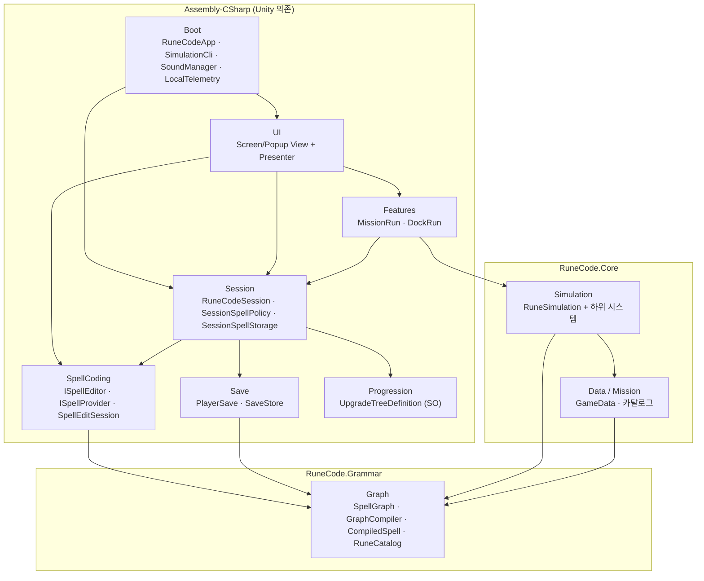
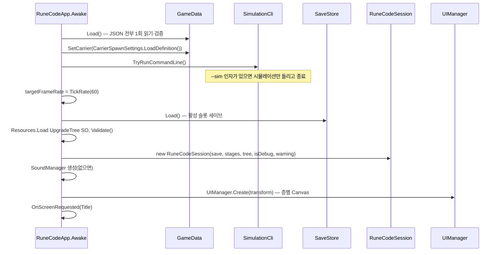
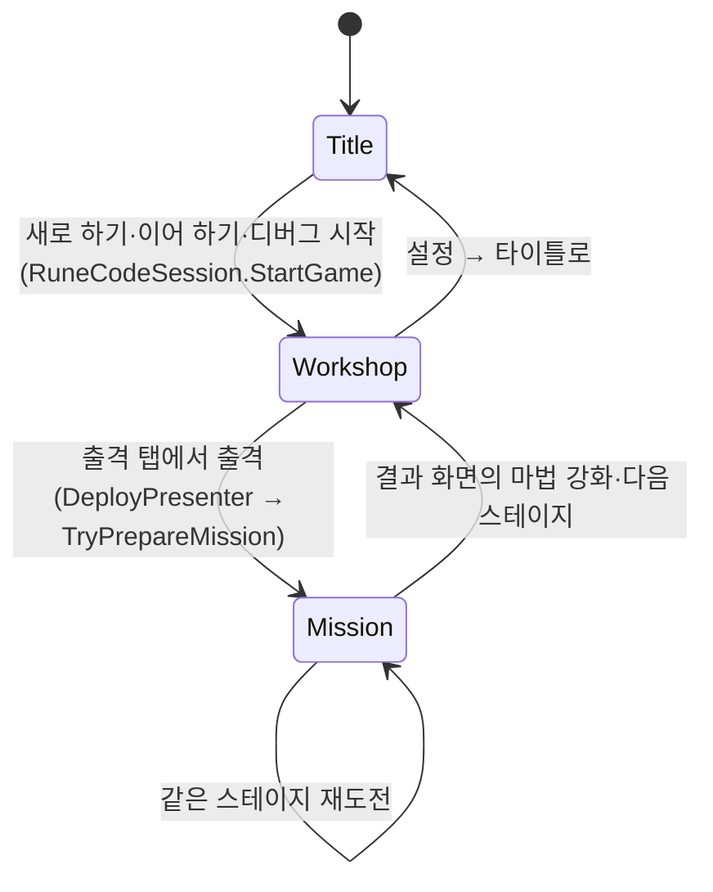

# 01. 전체 아키텍처

이 문서는 코드가 어떤 덩어리로 나뉘고, 서로 어느 방향으로 의존하며, 앱이 켜질 때 무엇이 어떤 순서로 만들어지는지 설명한다.

## 1. 기술 환경

| 항목 | 값 | 근거 |
|---|---|---|
| 엔진 | Unity 6000.3.22f1 | 루트 `README.md` |
| 씬 | `Assets/Scenes/Boot.unity` 하나 | 화면 전환은 씬 전환이 아니라 Prefab 표시·숨김 |
| 입력 | Input System 패키지 (`Keyboard.current`, `Mouse.current` 직접 조회) | `MissionRun.Step`, `UIManager.Update` |
| UI | uGUI + TextMeshPro | `UI/` 전체 |
| 사운드 | FMOD for Unity | `Boot/SoundManager.cs` |
| 데이터 | `Resources/RuneCode/*.json` + ScriptableObject(`UpgradeTree.asset`) + 일부 Prefab 설정 | `GameData.Load` |

## 2. 어셈블리와 폴더

```
Assets/RuneCode/
├─ Core/                      ← RuneCode.Core 어셈블리 (Core/Graph 제외)
│  ├─ Graph/                  ← RuneCode.Grammar 어셈블리 (Unity 참조 없음)
│  │  ├─ Behaviors/           행동 컴파일 규칙 (SpellBehaviorRules 5종)
│  │  └─ Modifiers/           동작 모드 컴파일 규칙 (SpellModifierRules 6종)
│  ├─ Data/                   GameData(정적 데이터 허브), BalanceData, ShareCodec, 직렬화 형식
│  ├─ Mission/                적·스테이지·드롭·보스 데이터 정의와 카탈로그
│  └─ Simulation/             결정적 전투 시뮬레이션 (Unity 참조 없음)
│     ├─ Behaviors/           행동 실행 동작 (SpellBehaviorRuntime 5종)
│     ├─ Modifiers/           동작 모드 실행 동작 (SpellModifierRuntime 6종)
│     ├─ Execution/           마법 실행 문맥·예약·추적
│     ├─ Enemies/, Spawning/, Stats/
├─ Boot/                      ← Assembly-CSharp. 앱 진입점, CLI, 사운드, 텔레메트리
├─ Session/                   앱 수명 동안 유지되는 진행 상태 (RuneCodeSession)
├─ Save/                      세이브 데이터 형식과 파일 입출력
├─ SpellCoding/               마법 편집 경계(인터페이스)와 편집 세션
├─ Features/                  전투 한 판을 구동하는 모델 (MissionRun, DockRun)
├─ Progression/               강화 트리 ScriptableObject 정의
├─ UI/                        화면·팝업 View와 Presenter
├─ Editor/                    ← Assembly-CSharp-Editor. 스테이지·강화 트리 편집 창, 빌드 후처리
├─ Prefabs/, Art/, Input/
└─ Resources/RuneCode/        런타임 로드 데이터와 UI Prefab
```

| 어셈블리 | 경로 | 참조 | 특징 |
|---|---|---|---|
| `RuneCode.Grammar` | `Core/Graph` | 없음 | `noEngineReferences: true`. Unity 없이 컴파일되는 마법 문법·컴파일러 |
| `RuneCode.Core` | `Core` (Graph 제외) | Grammar | Simulation 폴더는 `UnityEngine`을 쓰지 않는다. Data·Mission 폴더는 `JsonUtility`·`[SerializeField]` 때문에 `UnityEngine`을 쓴다 |
| `Assembly-CSharp` | 나머지 런타임 폴더 | Core, Grammar(자동 참조) | MonoBehaviour·UI·세션·세이브 |
| `Assembly-CSharp-Editor` | `Editor` | 위 전체 | 에디터 전용 도구 |

`RuneCode.Core` 안의 시뮬레이션 하위 시스템(`SimulationWorld`, `SpellExecutor` 등)은 대부분 `internal`이다. UI·Features 코드는 `RuneSimulation`의 `public` 속성·메서드만 사용할 수 있으므로, **시뮬레이션의 외부 계약은 `RuneSimulation` 하나**라고 보면 된다.

## 3. 계층과 의존 방향



의존 규칙 요약:

- **Grammar는 아무것도 참조하지 않는다.** 그래프·룬 정의·컴파일러·실행 트리(`SpellAction`)는 순수 C#이다.
- **Simulation은 Unity를 모른다.** 입력은 `SimulationInput` 구조체로 받고, 결과는 `RuneSimulation`의 읽기 전용 목록으로 노출한다. 그래서 같은 시뮬레이션을 미션·시험 도크·명령행(CLI)이 공유한다.
- **편집 UI는 `ISpellEditor`만, 그 밖의 기능은 `ISpellProvider`만** 통해 마법에 접근한다(`SpellCoding/Contracts`). 편집 UI는 세이브 구조나 도크를 직접 참조하지 않고 `ISpellEditorHost`로 필요한 값만 받는다.
- **세션이 진행 상태의 단일 소유자다.** 화면들은 세션을 받아 읽고, 변경은 세션 메서드(`BuyUpgradeNode`, `SettleMission`, `GrantRune` 등)로 요청한다.

## 4. 부팅 순서

`Boot.unity`에 놓인 `RuneCodeApp`(MonoBehaviour)이 앱의 유일한 진입점이다. 에디터에서 다른 씬을 열고 Play해도 `RuneCodeApp.EnsureBootScene`이 Boot 씬을 강제로 로드한다.



| 단계 | 코드 | 실패 시 |
|---|---|---|
| 정적 데이터 로드 | `GameData.Load()` | 데이터 오류는 `FormatException`으로 부팅을 멈춘다 |
| 캐리어 설정 | `CarrierSpawnSettings.LoadDefinition()` → `GameData.SetCarrier` | Prefab이 없거나 적 ID가 잘못되면 예외 |
| CLI 분기 | `SimulationCli.TryRunCommandLine()` | `--sim`이면 결과 JSON을 쓰고 `Application.Quit` |
| 세이브 로드 | `SaveStore.Load()` | 없거나 손상되면 새 진행. 경고 문구는 `SaveStore.LastWarning` |
| 강화 트리 | `Resources.Load<UpgradeTreeDefinition>("RuneCode/UpgradeTree")` + `Validate` | 자산이 없거나 구조 오류면 예외 |
| 디버그 여부 | 명령행 `-debug` 또는 URL `debug=1` | 디버그 세션은 세이브 대신 메모리 진행을 쓴다 |
| 세션 생성 | `new RuneCodeSession(...)` | 마법 편집 세션(`SpellEditSession`)도 여기서 만든다 |
| UI 관리자 | `UIManager.Create` | Screen(0)·Popup(100)·System(200) 정렬 순서의 Overlay Canvas 3개 |

`RuneCodeApp`은 이후 다음만 담당한다.

- `RuneCodeSession.ScreenRequested` 이벤트를 받아 `UIManager.ShowScreen<T>`로 화면을 바꾼다. 전환 도중 들어온 요청은 `_pendingScreen`에 담아 현재 전환이 끝난 뒤 처리한다.
- `F8` 키로 로컬 텔레메트리 링 버퍼를 콘솔에 출력한다.
- 앱 종료 시 사용성 로그를 닫고 `RuneCodeSession.SaveAll()`로 저장한다.

## 5. 화면 구조

앱 화면은 `AppScreen` 열거형의 세 가지뿐이며, 각각 `Resources/RuneCode/UI/{타입 이름}.prefab`에서 처음 한 번 만들어 이후 숨김·재표시로 재사용한다.



| 화면 | View(MonoBehaviour) | Presenter | 내부 구성 |
|---|---|---|---|
| 타이틀 | `TitleScreen` | `TitlePresenter` | 단일 진행 새로 하기·이어 하기, 설정 팝업 |
| 작업실 | `WorkshopScreen` | `WorkshopPresenter` | 마법 편집 패널 + 시험 도크(에디터 탭), 강화 트리 탭, 출격(스테이지 선택) 영역 |
| 미션 | `MissionScreen` | `MissionPresenter` | 월드 표시(`MissionWorldView`), HUD, 결과 패널 |

결과 화면은 별도 `AppScreen`이 아니라 미션 화면 안의 `ResultPanel`이다. 자세한 UI 구조는 [05_UI.md](05_UI.md)에 있다.

## 6. 객체 수명 한눈에 보기

| 객체 | 생성 시점 | 소멸 시점 | 소유자 |
|---|---|---|---|
| `GameData`의 카탈로그 | 부팅 1회 | 앱 종료 | 정적 클래스 |
| `RuneCodeSession` | 부팅 1회 | 앱 종료 | `RuneCodeApp` |
| `PlayerSave` | 부팅·슬롯 선택·초기화 시 교체 | 교체 시 | `RuneCodeSession` |
| `SpellEditSession` | 세션 생성 시 1회 | 앱 종료 | `RuneCodeSession` (`Spells`로 노출) |
| 화면 View + Presenter | 해당 화면 첫 표시 | 앱 종료(재사용) | `UIManager` |
| `DockRun` + 도크 `RuneSimulation` | `WorkshopPresenter` 생성 시 / 도크 시작·리셋마다 시뮬레이션 재생성 | 작업실 Presenter 파기 | `WorkshopPresenter` |
| `MissionRun` + 미션 `RuneSimulation` | 미션 화면 표시마다 새로 | 미션 화면 숨김 | `MissionPresenter` |
| `MissionWorldView` | 미션 화면 첫 초기화 | `MissionScreen` 파기 | `MissionScreen` (씬 루트에 별도 생성) |

## 7. 전역·정적 접근점

구조를 이해할 때 "어디서든 접근하는 것"을 알아 두면 추적이 쉽다.

| 접근점 | 용도 | 주의 |
|---|---|---|
| `GameData` (static) | 룬·밸런스·적·스테이지·드롭·문자열 등 모든 정적 데이터, `GameData.L(key)` 현지화 | 시뮬레이션 생성은 `SimulationSetup.FromGameData`로 한 번 읽어 넘긴다. 행동·모드 런타임 일부는 `GameData.Runes.Get`을 직접 부른다 |
| `SoundManager.Instance` | 효과음·음악 | 싱글턴. `RuneCodeApp`이 없으면 만든다 |
| `LocalTelemetry` (static) | 링 버퍼 로그(F8)와 사용성 테스트 로그 | 기능 코드(MissionRun, DockRun, Presenter) 곳곳에서 호출 |
| `SaveStore` (static) | 슬롯 파일 입출력, PlayerPrefs 설정 | 세이브 쓰기는 세션을 거쳐 호출하는 것이 원칙 |
| `SpellBehaviorRuleRegistry` 등 4개 레지스트리 (static) | 행동·모드 규칙과 실행 동작 등록 목록 | 새 행동·모드 추가 시 여기에 한 줄 등록 ([03](03_SpellGraph_Compile.md) 7절) |
