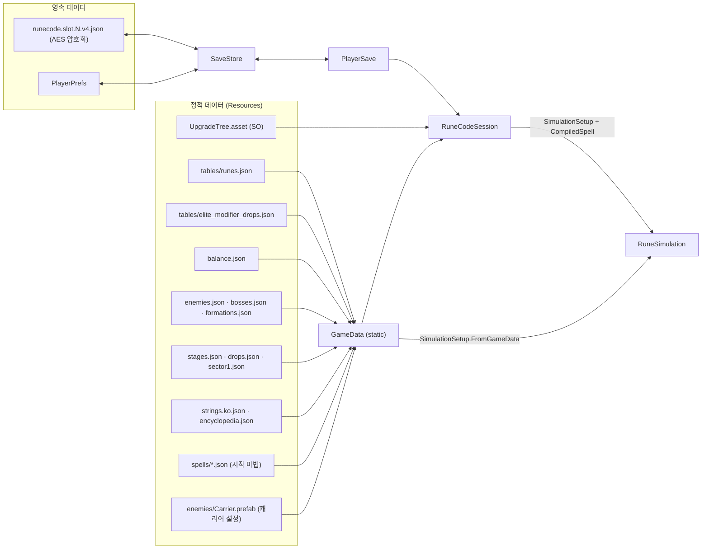
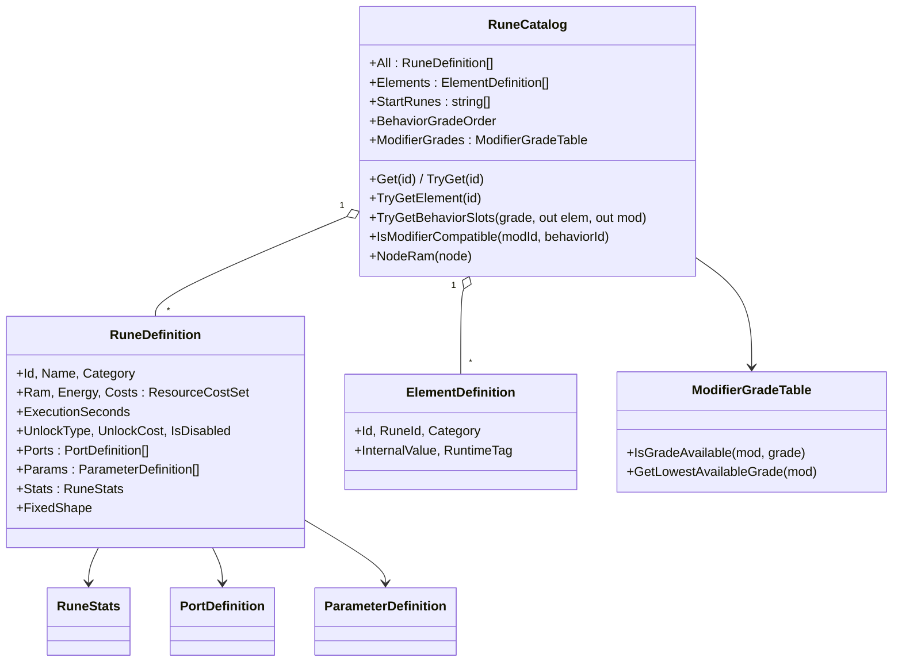

# 02. 데이터 구조와 관리

RuneCode의 데이터는 수명과 소유자에 따라 다섯 층으로 나뉜다. 어떤 값을 바꾸고 싶을 때 **그 값이 어느 층에 있는지** 먼저 확인하면 수정 위치를 바로 찾을 수 있다.

| 층 | 수명 | 소유자 | 대표 예 |
|---|---|---|---|
| 정적 데이터 | 앱 전체, 읽기 전용 | `GameData`(static), `UpgradeTreeDefinition`(SO) | 룬 정의, 밸런스 수치, 스테이지 편성, 적 능력치, 문자열 |
| 영속 진행 데이터 | 디스크(세이브 파일) | `PlayerSave` ← `SaveStore` | 스크랩, 클리어 기록, 마법 보관함, 룬 소지량, 트리 레벨 |
| 기기 설정 | 디스크(PlayerPrefs) | `SaveStore` | 활성 슬롯, 자동 저장, 화면 흔들림, 음량 |
| 세션 상태 | 앱 실행 동안 | `RuneCodeSession`, `SpellEditSession` | 편집 중 그래프 사본, 도크 옵션, 상태 문구, 디버그·테스트 모드 |
| 전투 상태 | 전투 한 판 | `RuneSimulation`(+하위 시스템), `MissionRun`/`DockRun` | 플레이어·적·마법 개체 위치, 쿨다운, 획득 스크랩 |



---

## 1. 정적 데이터 로딩: `GameData`

`Core/Data/GameData.cs`는 모든 정적 데이터의 단일 진입점이다. 부팅 시 `GameData.Load()`가 한 번 실행되며, 이미 로드됐으면(`IsLoaded`) 다시 읽지 않는다.

### 1.1 로드 순서와 검증

`GameData.Load()`는 아래 순서로 읽고 하나라도 실패하면 `FormatException`을 던져 부팅을 멈춘다. 모든 카탈로그를 지역 변수로 만든 뒤 **마지막에 한꺼번에 정적 필드에 대입**하므로, 중간에 실패해도 반쯤 로드된 상태가 남지 않는다.

| 순서 | 파일 (`Resources/RuneCode/`) | 결과 타입 | 검증 |
|---|---|---|---|
| 1 | `strings.ko.json` | `Dictionary<string,string>` | 키 중복·빈 키 금지 |
| 2 | `tables/runes.json` | `RuneCatalog` | `RuneCatalog.FromTable`이 오류를 모아 한 번에 보고(`TableErrorLog`) |
| 3 | (레지스트리 대조) | — | 활성 `behavior` 룬마다 행동 규칙 등록 여부, 규칙마다 실행 동작 등록 여부, 모드 규칙과 실행의 짝 (`ValidateBehaviorRegistries`, `ValidateModifierRegistries`) |
| 4 | `tables/elite_modifier_drops.json` | `ModifierGradeTable` | 룬 카탈로그와 대조. 이후 `runes.AttachModifierGrades`로 카탈로그에 연결 |
| 5 | `balance.json` | `BalanceData` | |
| 6 | `spells/energybolt.json`, `spells/triplemissile.json` | `IReadOnlyList<SpellGraph>` | 모든 룬 해금 상태로 컴파일해 오류가 없어야 함 |
| 7 | `enemies.json` | `EnemyCatalog` | |
| 8 | `sector1.json` | `SectorDefinition` | |
| 9 | `formations.json` | `FormationCatalog` | |
| 10 | `bosses.json` | `BossCatalog` | 적·진형 카탈로그 참조 검사 |
| 11 | `drops.json` | `DropCatalog` | |
| 12 | `stages.json` | `StageCatalog` | 적·진형·드롭 카탈로그 참조 검사 |
| 별도 | `encyclopedia.json` | `EncyclopediaData` | 처음 접근할 때 지연 로드. 실패하면 null 보관 |
| 별도 | 캐리어 Prefab | `CarrierDefinition` | `RuneCodeApp`이 `GameData.SetCarrier`로 등록하며 적 카탈로그로 검증 |

### 1.2 공개 접근자

| 속성 | 타입 | 내용 |
|---|---|---|
| `GameData.Runes` | `RuneCatalog` | 룬 정의, 속성 정의, 모드 장착 대상, 행동 등급별 슬롯 수, 시작 해금 룬 |
| `GameData.ModifierGrades` | `ModifierGradeTable` | 모드 등급별 효과량, 스테이지별 등급 확률 |
| `GameData.Balance` | `BalanceData` | 플레이어·한도·적응·전투·경제·RAM·시뮬레이션 수치 |
| `GameData.Spells` | 시작 마법 템플릿 | `FindSpell(id)`로 조회 |
| `GameData.Enemies`, `Bosses`, `Formations`, `Drops`, `Stages`, `Sector`, `Carrier` | 전투 카탈로그 | 시뮬레이션 생성 시 `SimulationSetup`으로 전달 |
| `GameData.Encyclopedia` | 도움말 | 온보딩·도움말 팝업 |

### 1.3 현지화 문자열

- `GameData.L(key)`: 문자열을 반환하고, 없으면 키 자체를 반환한다. 에디터·개발 빌드에서는 누락 키마다 한 번 경고를 남긴다.
- `GameData.TryL(key, out value)`: 선택적 문구 존재 확인용. 경고를 남기지 않는다.
- `GameData.Format(key, ("name", value), ...)`: 문구의 `{name}` 자리를 치환한다.
- 파일은 `strings.ko.json`의 `_entries` 배열(`_key`, `_value`)이며 현재 약 480개 키가 있다.
- 룬 설명은 `rune.{id}.desc`, 모드 효과는 `rune.effect.*`, 컴파일 오류 문구는 `CompileIssueText`가 코드별 키로 만든다.

---

## 2. 정적 데이터 파일별 스키마

모든 JSON은 Unity `JsonUtility`로 읽으므로 **필드 이름이 C# 직렬화 필드 이름(`_camelCase`)과 같아야 한다.** 필드 이름을 바꾸면 기존 데이터가 조용히 기본값으로 읽힐 수 있다.

### 2.1 `tables/runes.json` — 룬 정의

루트는 `_behaviorGrades`(행동 등급별 슬롯 수)와 `_runes`(룬 행 목록)이다.

```json
"_behaviorGrades": [
  { "_grade": "C", "_elementSlots": 1, "_modifierSlots": 3 },
  { "_grade": "B", "_elementSlots": 1, "_modifierSlots": 4 },
  { "_grade": "A", "_elementSlots": 1, "_modifierSlots": 5 },
  { "_grade": "S", "_elementSlots": 1, "_modifierSlots": 6 }
]
```

룬 행(`RuneRowData`)의 주요 필드:

| 필드 | 의미 |
|---|---|
| `_id` | 룬 ID. 접두사로 종류를 구분한다(`core.`, `behavior.`, `element.`, `mod.`, `form.`, `elem.`, `shape.`, `magic.`) |
| `_name` | 표시 이름 |
| `_category` | `core`, `behavior`, `element`, `modifier`, `shape`, `internal` 등 |
| `_ram` | 연결 시 RAM 사용량 |
| `_energy` / `_resourceCosts` | 전력(mana) 등 자원 비용 |
| `_element` | `element` 카테고리 룬의 속성 데이터(`_id`, `_category`=elemental/functional, `_internalValue`, `_runtimeTag`) → `ElementDefinition` |
| `_executionSeconds`, `_executionSecondsPerArea` | 노드 실행 시간(완료까지 지연) |
| `_unlockType` | `start`(시작 보유), `tree`(강화 트리로 해금), `bench`(벤치 해금) |
| `_unlockCost` | 해금 비용 |
| `_disabled` | 팔레트·획득·컴파일에서 제외 |
| `_stats` | 피해·반경·속도·수명·각도·개수 등 수치(`RuneStats`) |
| `_ports` | 포트 목록(`_portId`, `_kind`=exec/mod, `_direction`=in/out, `_max`) |
| `_params` | 노드 파라미터 정의(예: `core.cast`의 `trigger` 열거형) |
| `_tags` | 적응 학습 태그 |
| `_modifierTargets` | 모드 룬이 장착될 수 있는 행동 룬 ID 목록 |
| `_shape` | 행동 룬의 고정 형태(`sphere` 등) → `RuneDefinition.FixedShape` |

현재 룬은 역할에 따라 이렇게 나뉜다.

| 분류 | 룬 ID | 비고 |
|---|---|---|
| 시작 조건 | `core.cast` | 그래프마다 정확히 1개, 삭제 불가 |
| 행동(플레이어가 배치) | `behavior.launch`(발사), `behavior.burst`(폭발), `behavior.persist`(잔류), `behavior.beam`(빔), `behavior.slash`(참격) | 노드로 배치하는 유일한 룬 종류 |
| 속성(슬롯 장착) | `element.neutral`, `element.fire`, `element.ice`, `element.lightning` | 각 행의 `_element` 필드가 `ElementDefinition`을 만든다 |
| 모드(슬롯 장착) | `mod.knockback`, `mod.saving`, `mod.amplify`, `mod.multi`, `mod.beamEmpower`, `mod.pierce`, `mod.homing`, `mod.orbit`, `mod.expand`, `mod.speed`, `mod.duration` | 장착 대상은 `_modifierTargets` |
| 내부 수치 | `form.bolt`, `form.burst`, `form.zone`, `form.beam`, `form.slash`, `elem.fire`, `elem.ice`, `elem.arc` | 행동·속성의 실제 수치·비용. 행동 규칙의 `StatsRuneId`(`form.{Kind}`)가 가리킨다 |
| 내부 표현 | `magic.inline`, `shape.sphere`, `shape.box`, `shape.cone` | 컴파일러 내부의 Inline Magic 표현과 형태 프리셋 |

**행동 룬과 수치 룬이 분리돼 있다는 점이 중요하다.** 예를 들어 발사의 피해·속도를 바꾸려면 `behavior.launch`가 아니라 `form.bolt`의 `_stats`를 고친다.

### 2.2 `tables/elite_modifier_drops.json` — 모드 등급표

`ModifierGradeTable`로 읽힌다.

| 필드 | 의미 |
|---|---|
| `_gradeOrder` | `["C","B","A","S"]` |
| `_modifierGradeEffects[]` | 모드별 효과 타입(`_effectType`), 등급별 효과값(`_gradeValues`), 등급별 비용 배율(`_energyMultByGrade`) |
| `_stageDropTables[]` | 스테이지별 모드 등급 확률(`_eliteModifierGradeChancesPercent`), 행동 등급 확률(`_behaviorGradeChancesPercent`), 보스 선택 보상 설정 |
| `_dataNotes` | 사람용 설명. 코드가 읽지 않는다 |

모드별 효과 타입(코드 상수는 `ModifierGradeTable`의 `*_EFFECT`):

| 모드 | 효과 타입 | C / B / A / S |
|---|---|---|
| `mod.saving` 절약 | `energyCostMultiplier` | 비용 배율 0.95 / 0.9 / 0.8 / 0.7 |
| `mod.amplify` 효과 증폭 | `effectMultiplier` | 1.5 / 1.95 / 2.8 / 4.5 |
| `mod.multi` 다중 | `multipleCount` | 발사·빔·참격: 생성 개수 2 / 3 / 4 / 5, 피해 ×0.7. 폭발: 생성 개수 1, 회차 2 / 2 / 3 / 4·0.2초, 피해 ×0.8. 잔류는 장착 불가 |
| `mod.pierce` 관통 | `pierceCount` | 1 / 3 / 7 / 999(무제한) |
| `mod.expand` 확장 | `radiusMultiplier` (면적 배율) | 1.5 / 2 / 2.7 / 4 |
| `mod.duration` 지속시간 | `durationMultiplier` | 1.5 / 2 / 2.5 / 3 |
| `mod.speed` 속도 | `speedMultiplier` | 1.5 / 2 / 2.7 / 4 |
| `mod.homing` 유도 | `homingTier` | 없음 / 하급 / 중급 / 상급 |
| `mod.orbit` 공전 | `orbitPath` | 1 / 2 / 3 / 4 |
| `mod.knockback` 밀어내기 | `knockbackDistance` | 30 / 45 / 60 / 90 |
| `mod.beamEmpower` 과충전 | `beamEmpowerMultiplier` | 2 / 2.67 / 3.33 / 4 (+전력·크기 배율) |

등급 값이 `null`인 등급은 그 모드에 존재하지 않는 등급이다(예: 유도 C). `ModifierGradeTable.IsGradeAvailable`과 `GetLowestAvailableGrade`가 이를 반영한다.

### 2.3 `balance.json` — 밸런스

`BalanceData`의 7개 섹션이다. 시뮬레이션·경제·문법 한도가 모두 여기에 있다.

| 섹션 | 클래스 | 주요 값 (현재) |
|---|---|---|
| `_player` | `PlayerBalance` | 최대 체력 100, 이동 220px/s, 최대 전력 100, 전력 회복 15/s, 대시 140px·0.18s·쿨다운 1s, 피격 무적 0.5s |
| `_limits` | `LimitBalance` | 동시 마법 개체 128, 프레임당 최대 스텝 5, 그래프 노드 256·엣지 1024, 적 상한 300, 컴파일 행동 2048, 예약 실행 2048, 틱당 행동 512 |
| `_ram` | `RamBalance` | 쿨다운 = 0.25 + 0.03 × RAM |
| `_adaptation` | `AdaptationBalance` | 적응 학습률·상한·감쇠 |
| `_combat` | `CombatBalance` | 화상(비율 0.1·간격 0.5s·3s), 냉기(감속 0.3·2.5s·최대 3스택), 빙결 1s·면역 4s, EMP 2s, 이지스·릴레이·적 분리 수치 |
| `_economy` | `EconomyBalance` | 실패 보존율 0.7, 기본 RAM 용량 6, 보관함 최대 30, 행동 시작 소지 1, 줍기 반경 80, 끌어당김 480px/s, 처치 전력 회복 비율 0.3 |
| `_sim` | `SimulationBalance` | 틱레이트 60, 시험 도크 배치 좌표, 지팡이 오프셋 8, 범위 배치 사거리 240, 실행 시간 배율 1 |

`BalanceData.Grammar`는 `_limits`(노드·엣지·컴파일 행동·동시 개체 한도), `_economy.BaseCapacity`, `_player.MaxEnergy`, `_ram`(쿨다운 공식)으로 `GrammarLimits`(컴파일러 한도)를 만들어 캐싱한다.

### 2.4 `enemies.json` — 적 정의

`_enemies[]`의 각 행이 `EnemyDefinition`이다. 현재 15종: `enemy.scout`, `sentry`, `hunter`, `aegis`, `relay`, `splitter`(+`_mid`, `_small`), `bomb_seed`, `clock_sniper`, `shield_melee`, `shield_ranged`, `carrier`, `interceptor`, `boss.governor`.

| 필드 묶음 | 필드 |
|---|---|
| 기본 | `_id`, `_hp`, `_speed`, `_radius`, `_damage`, `_reward`, `_sides`(표시 다각형 변 수), `_dropTable` |
| 이동 | `_movement` = `chase` / `turret` / `anchor` / `dashChase` / `keepDistance` / `sniper` / `interceptor`, `_preferredDistance`, `_moveSeconds`, `_stopSeconds` |
| 공격 | `_attack` = `none` / `contact` / `burst` / `dashContact` / `sniper` / `interceptor`, `_attackInterval`, `_attackRange`, `_warningSeconds`, `_dashSpeed`, `_dashSeconds`, `_aimSeconds`, `_lockSeconds` |
| 탄환 | `_projectileSpeed`, `_projectileRadius`, `_projectileLifetime`, `_spreadDegrees`, `_burstInterval` |
| 특성 | `_traits` = `aegisShield` / `relayAura` / `deathExplosion` / `circleShield` / `carrier`, `_explosionRadius`, `_explosionDamage`, `_shieldRadius` |
| 분열 | `_splitInto`, `_splitCount`, `_splitDelay` |

적의 **표시**는 별도로 관리한다. `MissionWorldView`가 `Resources.LoadAll<EnemyView>("RuneCode/enemies")`로 종류 전용 View Prefab(`EnemyView.EnemyId`로 구분)을 읽고, 전용 Prefab이 없는 적은 `Prefabs/Mission/MissionEnemy.prefab`으로 그린다. 적 정보가 JSON과 Prefab 두 곳에 나뉘어 있다.

### 2.5 `stages.json` — 스테이지 편성

루트(`StageCatalog`):

| 필드 | 의미 |
|---|---|
| `_map` | 맵 크기. 현재 50×50 타일(타일 32px → 1600×1600px) |
| `_growth` | 스테이지당 적 체력 +15%, 피해 +5% |
| `_spawn` | 원형 슬롯 수 20, 예고 0.8s, 플레이어 최소·최대 거리 240·650, 스폰 직후 접촉 유예 0.3s 등 |
| `_stationaryAdvanceSpeed` | 고정형 적이 미션에서 다가오는 속도 |
| `_rewards[]` | 적 ID별 처치 보상 덮어쓰기 |
| `_progressionStages[]` | 연속 미션 편성. 스테이지 3개 × 라운드 6개 × 웨이브 3개 고정 |

연속 미션 편성(`ProgressionStageDefinition` → `ProgressionRoundDefinition` → `WaveDefinition`):

| 위치 | 필드 | 의미 |
|---|---|---|
| 스테이지 | `_stage` | 1부터 시작하는 스테이지 번호 |
| 스테이지 | `_eliteTypes[]` | 엘리트 정의. 적 ID, 배율(체력·보상·속도·반경), 드롭 테이블·확률. 웨이브 유닛의 `_isElite`가 이 정의를 쓴다 |
| 스테이지 | `_rounds[]` | 라운드 6개 |
| 라운드 | `_waves[]` | 웨이브 3개. 앞 웨이브를 모두 처치하면 다음 웨이브가 나온다 |
| 라운드 | `_rewardDropTable` | 라운드 종료 시 3개 중 1개 선택 보상을 추첨할 `drops.json` 테이블 ID. 6라운드는 스테이지 종료 보상 테이블(아래) |
| 웨이브 | `_formation` | 진형 ID와 덮어쓰기(`_angle`·`_spacing`·`_interval`·`_slots`, 빈 값·0은 원본 유지) |
| 웨이브 | `_units[]` | 적 ID·수량·엘리트 여부 |

3라운드 마지막 웨이브에는 미니 보스 1기, 6라운드 마지막 웨이브에는 보스 1기가 있어야 한다. 메뉴 `Rune Code/Stage Table Editor`(`Editor/StageTableEditorWindow`)로 이 파일을 폼 형태로 편집할 수 있다.

라운드가 끝나면 `_rewardDropTable`의 드롭 테이블에서 서로 다른 룬 3개를 추첨해 1개를 고르게 한다. 6라운드(스테이지 종료)는 스테이지마다 다른 테이블(`drop.stageClear.N`)을 쓰며 6라운드 라운드 보상을 대체한다. 현재 기본 연결은 1·2·4·5라운드 `drop.round.modifier`, 3라운드 `drop.round.behavior`, 6라운드 `drop.stageClear.1~3`이다. 3스테이지는 라운드 대기 없이 바로 완료되므로 `drop.stageClear.3`은 아직 쓰이지 않는다.

```json
{
  "_id": "drop.round.behavior",
  "_categoryChances": [
    { "_category": "behavior", "_percent": 100 },
    { "_category": "modifier", "_percent": 0 },
    { "_category": "element", "_percent": 0 }
  ],
  "_gradeChances": [
    { "_category": "behavior", "_grade": "C", "_percent": 30 },
    { "_category": "behavior", "_grade": "S", "_percent": 70 }
  ],
  "_entries": [
    { "_type": "behavior", "_id": "behavior.launch", "_weight": 1 },
    { "_type": "behavior", "_id": "behavior.burst", "_weight": 1 }
  ]
}
```

드롭 테이블(라운드 보상·엘리트 드롭 공통)은 한 번에 룬 1개를 다음 순서로 추첨한다.
1. `_categoryChances`로 분류(behavior 행동, modifier 강화, element 속성)를 고른다. 합은 100이어야 한다.
2. 그 분류의 `_gradeChances`로 등급을 고른다. 분류마다 합은 100이어야 하고, 속성은 등급이 없다. 분류의 등급 행이 없으면 `elite_modifier_drops.json`의 스테이지 등급표(Modifier·행동)를 따른다.
3. 그 분류의 `_entries` 중 굴린 등급을 지원하는 후보에서 `_weight`(같은 분류 안의 비율)로 고른다. 분류의 후보가 없으면 그 분류의 활성 룬 전체를 같은 가중치로 쓴다(속성은 일반 속성 제외). 확률이 있는 분류·등급마다 후보가 1개 이상 있어야 한다.

라운드 보상은 같은 테이블에서 서로 다른 룬 3개를 뽑는다. 라운드 보상 테이블에는 속성 확률을 둘 수 없고, 확률이 있는 분류·등급마다 후보가 3개 이상 필요하다.
메뉴 `Rune Code/Stage Table Editor`의 [드롭 테이블] 탭(`Editor/DropTableEditorTab`)에서 테이블 추가·복제·삭제, 분류·등급 확률(합계 100 표시)과 후보를 편집할 수 있고, 저장 전에 `drops.json`과 이를 참조하는 `stages.json`을 런타임 로더로 함께 검증한다.

Modifier의 등급별 효과 값은 기존 `tables/elite_modifier_drops.json`을 참조한다.
행동은 `tables/runes.json`의 `_behaviorGrades`에 정의된 등급을 지원하며, 비활성 행동은 후보로 사용할 수 없다.
행동 ID는 `behavior.launch`, `behavior.burst`, `behavior.persist`, `behavior.beam`, `behavior.slash`이다.
선택한 행동은 추첨된 등급으로 소지량에 1개 추가된다.
라운드 보상에는 더 이상 해당 파일의 5스테이지 클리어 보상 확률을 사용하지 않는다.
Stage Table Editor의 진행 편성 탭에서도 선택한 라운드의 보상을 편집하고 같은 규칙으로 검증할 수 있다.

### 2.6 그 밖의 전투 데이터

| 파일 | 타입 | 내용 |
|---|---|---|
| `formations.json` | `FormationCatalog` | 진형 ID → 모양(`ringRandomSlot`, `ringAllSlots`, `pointSequence`, `ringDouble`, `ringHalf`, `ringSectorBlock` 등), 시작 각도 규칙(`random`/`ahead`/`fixed`), 간격 |
| `bosses.json` | `BossCatalog` | 보스 패턴(`governor`): 페이즈 임계(0.67/0.34), 패치 시간, 방사·조준 사격 주기, 장판, 증원 |
| `drops.json` | `DropCatalog` | 일반 적 드롭 확률(스테이지별), 드롭 테이블(분류 확률 `_categoryChances`, 분류별 등급 확률 `_gradeChances`, 후보 룬·가중치 `_entries`) |
| `sector1.json` | `SectorDefinition` | 타일 크기 32, 플레이어 반경 12, 시험 도크 맵 타일 문자열(`_benchTiles`) |
| `encyclopedia.json` | `EncyclopediaData` | 온보딩·도움말 항목(제목, 페이지 본문·영상·이미지 경로) |
| `spells/*.json` | `SpellGraphData` | 시작 마법 템플릿(현재 `core.cast` 노드만 가진 빈 마법) |

### 2.7 ScriptableObject와 Prefab 설정

| 자산 | 타입 | 내용 | 로드 |
|---|---|---|---|
| `Resources/RuneCode/UpgradeTree.asset` | `UpgradeTreeDefinition` | 강화 노드 목록. 노드마다 ID, 요구 스테이지, 문구 키, 아이콘, 격자 위치, 효과 타입(`UpgradeEffectType`), 해금 룬 ID, 시작 레벨, 선행 노드, 레벨별 비용·효과량 | `RuneCodeApp.Awake` |
| `Resources/RuneCode/enemies/Carrier.prefab` 의 `CarrierSpawnSettings` | MonoBehaviour 설정 | 캐리어가 낳는 적(EnemyView 대상 목록), 간격 4s, 수 2, 거리 120, 최대 생존 6 | `CarrierSpawnSettings.LoadDefinition` |

`UpgradeEffectType`: `EnergyRegen`, `MaxEnergy`, `RamCapacity`, `CastSpeed`, `Damage`, `ScrapGain`, `MaxHp`, `MoveSpeed`, `RuneUnlock`, `ScrapPickupRange`, `KillEnergy`, `ScrapHeal`. `Editor/UpgradeTreeEditorWindow`(메뉴 `Rune Code/Upgrade Tree Editor`)로 격자 위에서 편집한다.

---

## 3. 정적 데이터 객체 모델 (Grammar 어셈블리)



`RuneCatalog`는 JSON 행(`RuneTableData` / `RuneRowData`)을 검증해 읽기 전용 `RuneDefinition`으로 바꾼다. JSON 직렬화 형식(`*Data` 클래스)과 런타임 정의 클래스가 분리돼 있어, 런타임 코드는 `RuneDefinition`만 쓴다.

---

## 4. 영속 데이터: `PlayerSave`와 `SaveStore`

### 4.1 파일 구조

| 항목 | 값 |
|---|---|
| 경로 | `Application.persistentDataPath/runecode.slot.{1~3}.v4.json` |
| 슬롯 수 | 3 (`SaveStore.SLOT_COUNT`) |
| 형식 | `JsonUtility` JSON을 AES-256-CBC로 암호화, 앞에 `RC-AES-CBC-1:` 표식. 표식이 없는 평문도 읽을 수 있다 |
| 쓰기 | 임시 파일에 쓴 뒤 원자적 교체, 직전 정상 파일 백업 (`WriteToSlot`) |
| 이전 파일 | `runecode.save.v1~v4.json`이 있으면 마이그레이션 후 백업으로 보존 |
| 데이터 버전 | `PlayerSave._version` 현재 5. v1→v2→…→v5 순차 이전(`PlayerSave`의 Migrate 계열) |

암호화 키는 코드(`SaveStore.SAVE_KEY_BASE64`)에 고정돼 있어 변조 방지보다는 평문 노출 방지 수준이다.

### 4.2 `PlayerSave` 필드

| 필드 | 의미 |
|---|---|
| `_currency` | 보유 스크랩 |
| `_highestClearedStage` | 최고 클리어 스테이지. 출격 가능 범위와 첫 클리어 판정에 쓴다 |
| `_selectedStage` | 출격 선택 스테이지 |
| `_activeSpellId`, `_library`, `_loadout` | 마법 보관함(`SpellGraphData` 목록)과 활성 마법·장착 슬롯 |
| `_unlockedRunes` | 해금된 룬 ID |
| `_modifierStock`, `_elementStock`, `_behaviorStock` | (룬 ID, 등급, 수량) 소지량 |
| `_upgradeNodeProgress` | 강화 트리 노드 ID별 구매 레벨 |
| `_killCounts` | 적 ID별 누적 처치 수 |
| `_onboardingStep`, `_seenOnboardingEvents` | 온보딩 진행 |
| `_screenShake`, `_hitStop` | 이전 버전 호환용 설정(현재는 PlayerPrefs가 원본) |

`PlayerSave`는 `ISerializationCallbackReceiver`를 구현한다. 저장 직전 실행 중 보관함(`SpellGraph`)을 직렬화 형식(`SpellGraphData`)으로 옮기고, 읽은 직후 되돌린다. 읽은 뒤 `Validate`로 룬·마법 참조를 검사하고, 알 수 없는 속성·모드를 가리키는 슬롯 값은 지운다.

### 4.3 소지량(Stock) 규칙

- 키는 `룬ID#등급` (`SpellGrammar.ModifierStockKey`). 속성은 등급이 없어 `element.fire#` 처럼 등급 부분이 빈 문자열이다.
- **소지량은 프리셋(마법)마다 독립적으로 검사한다.** 한 마법 안에 같은 키를 소지량보다 많이 배치할 수 없다(컴파일 오류 E21). 다른 마법의 배치는 합산하지 않는다.
- 합성 재료로 쓸 수 있는 수(미사용 수량)는 보관함 전체 배치를 뺀 값이다(`ISpellEditor.TryGetUnusedStock`).
- 지급은 `RuneCodeSession.GrantRune` / `GrantModifier`로만 한다. 테스트 모드에서는 지급하지 않는다.

### 4.4 기기 설정 (PlayerPrefs)

`runecode.save.active-slot`, `runecode.save.auto-save`, `runecode.settings.screen-shake`, `runecode.settings.hit-stop`, `runecode.settings.master-volume` / `bgm-volume` / `sfx-volume`. 세이브 파일과 별개로 기기 단위로 유지된다.

---

## 5. 세션 상태: `RuneCodeSession`

세션은 "현재 진행 중인 게임"을 대표하며, 세이브 데이터와 정적 데이터를 조합한 **파생 값**을 제공한다.

### 5.1 보유 상태

| 상태 | 설명 |
|---|---|
| `_save` / `_normalSave` | 현재 진행. 디버그·테스트 모드면 `_save`는 메모리 전용 새 진행이고 `_normalSave`는 원래 슬롯 데이터 |
| `_spells` | `SpellEditSession`. 외부에는 `ISpellEditor Spells`로 노출 |
| `_isDebugEnabled`, `_isTestMode` | 모드. 둘 중 하나라도 켜지면 `IsMemorySession` (슬롯에 쓰지 않음) |
| `_statusMessage`, `_statusRevision` | 작업실 상태 토스트 문구와 변경 번호 |
| `_isSaveDirty` | 미저장 변경 여부(자동 저장이 꺼져 있을 때 의미) |
| 도크 옵션 | `_dockScenario`, `_dockDummyCount`, `_dockAutoFire`, `_dockAdaptation`, `_dockSpeed` (작업실 재진입 후에도 유지) |
| 온보딩 대기열 | `_pendingOnboardingChapter`, `_pendingOnboardingEvents` |

### 5.2 파생 능력치

강화 트리 효과는 `GetUpgradeTreeEffectTotal(effectType)`이 **트리 SO의 레벨별 효과량 × 세이브의 노드 레벨**을 합산해 계산한다. 값을 저장하지 않고 매번 계산한다.

| 속성 | 계산 |
|---|---|
| `Capacity` | `Economy.BaseCapacity` + RamCapacity 효과 |
| `MaxEnergy` | `Player.MaxEnergy` + MaxEnergy 효과 |
| `MaxHp` | `Player.MaxHp` + MaxHp 효과 |
| `EnergyRegen` | `Player.EnergyRegen` + EnergyRegen 효과 |
| `DamageMultiplier` | 1 + Damage 효과 |
| `MoveSpeedMultiplier`, `ScrapGainMultiplier`, `ScrapPickupRangeMultiplier` | 1 + 해당 효과 |
| `ScrapHealRatio`, `KillEnergyBonus` | 해당 효과 |

이 값들이 미션·도크 시작 시 `SimulationSetup.FromGameData(...)`의 인자로 넘어가 전투에 반영된다.

### 5.3 저장 시점

| 이벤트 | 메서드 | 동작 |
|---|---|---|
| 진행 변경(구매·정산·지급) | `PersistProgress` | 미저장 표시, 자동 저장이 켜져 있으면 즉시 슬롯 기록 |
| 마법 편집 | `SpellEditSession`의 디바운스 저장 → `SessionSpellStorage.Persist` → `PersistSpellStorage` | 같은 자동 저장 정책 |
| 수동 저장 | `SaveManually` | 즉시 기록 |
| 앱 종료·타이틀 복귀 | `SaveAll` | 편집 사본 반영 |
| 메모리 세션 | — | 슬롯에 쓰지 않는다 |

---

## 6. 전투 상태 (요약)

전투 상태는 [04_Simulation.md](04_Simulation.md)에서 자세히 다룬다. 여기서는 소유 관계만 정리한다.

| 데이터 | 소유자 | 외부 노출 |
|---|---|---|
| 카탈로그 참조, 플레이어, 적·마법 개체·적 탄 목록, 맵, 틱, 난수 | `SimulationWorld` (internal) | `RuneSimulation.Player`, `Enemies`, `SpellEntities`, `EnemyProjectiles`, `Map`, `Tick` |
| 장착 마법, 예약 실행, 틱당 행동 예산 | `SpellExecutor` | `Loadout`, `DroppedExecutions` |
| 상태 이상 | `EnemyStatusSystem` | `HasEnemyStatus`, `GetChillStacks` |
| 스크랩 오브, 룬 드롭, 처치 수 | `LootSystem` | `Orbs`, `ItemDrops`, `KillCount`, `EarnedFragments` |
| 스폰 진행 | `SpawnSystem`, `SpawnDirector` | `SpawnWarnings`(표시), `SpawnedEnemies` |
| 통계 | `SimulationStats` | `TotalDamage`, `RollingDps`, 각종 이벤트 카운트 |
| 표시 전용 기록 | `SimulationFeedback` | `DamageNumbers`, `ArcLinks`, `HealPulses`, `BeamFlashes`, `NodeEvents` |

전투가 끝나면 `MissionRun.FinishMission`이 결과 값만 뽑아 `RuneCodeSession.SettleMission`에 넘기고, 시뮬레이션 객체는 다음 미션 시작 시 버려진다. **전투 상태는 세이브되지 않는다.**

---

## 7. 수정 위치 빠른 찾기

| 바꾸고 싶은 것 | 수정 위치 |
|---|---|
| 발사체 피해·속도·사거리 | `tables/runes.json`의 `form.bolt._stats` |
| 모드 등급별 효과량 | `tables/elite_modifier_drops.json`의 `_modifierGradeEffects` |
| 모드가 어느 행동에 붙는지 | `tables/runes.json`의 해당 `mod.*._modifierTargets` (+ 규칙 클래스 `CanAttachTo`) |
| 행동 등급별 슬롯 수 | `tables/runes.json`의 `_behaviorGrades` |
| 플레이어 체력·이동·대시 | `balance.json`의 `_player` |
| 화상·냉기 등 상태 이상 | `balance.json`의 `_combat` |
| 적 능력치 | `enemies.json` |
| 적 외형 | `Resources/RuneCode/enemies/*.prefab`, `Prefabs/Mission/MissionEnemy.prefab` |
| 스테이지 편성·제한시간·보상 | `stages.json` (Stage Table Editor 창 권장) |
| 드롭 확률 | `drops.json`(분류·등급 확률 포함). 테이블에 등급 확률이 없는 분류는 `elite_modifier_drops.json`의 `_stageDropTables` |
| 강화 트리 | `UpgradeTree.asset` (Upgrade Tree Editor 창) |
| 화면 문구 | `strings.ko.json` |
| 도움말·온보딩 | `encyclopedia.json`, `Resources/RuneCode/Onboarding/` |
