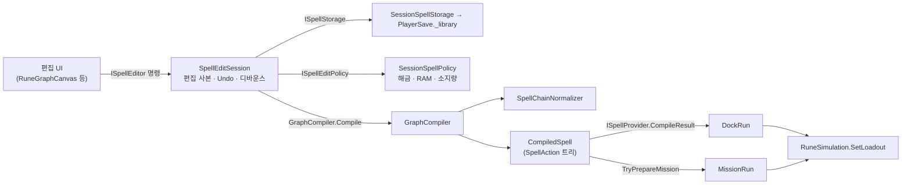
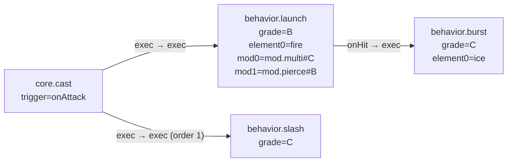
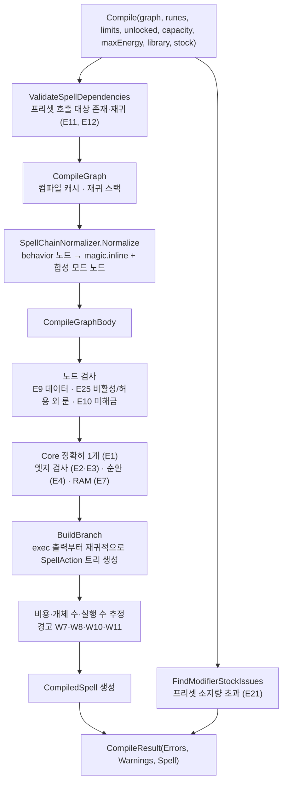

# 03. 마법 그래프와 컴파일

플레이어가 만드는 "마법"은 노드 그래프(`SpellGraph`)다. 그래프는 직접 실행되지 않고, **컴파일러가 검증한 뒤 실행 트리(`CompiledSpell` / `SpellAction`)로 바꿔 시뮬레이션에 넘긴다.** 이 문서는 그래프 데이터 모델, 편집 세션, 컴파일 파이프라인, 그리고 행동·모드를 확장하는 규칙 구조를 설명한다.

---

## 1. 그래프 데이터 모델

### 1.1 클래스 (`Core/Graph/SpellGraph.cs`)

| 클래스 | 필드 | 설명 |
|---|---|---|
| `SpellGraph` | `Id`, `Name`, `Version`(현재 4), `Nodes`, `Edges` | 마법 하나. `Create(id, name)`은 `core` 노드를 가진 새 그래프를 만든다 |
| `GraphNode` | `Id`, `RuneId`, `X`, `Y`, `Params` | 노드 하나. 좌표는 편집 화면 표시용이며 실행 의미가 없다 |
| `NodeParameter` | `Key`, `Number`, `Text` | 노드 파라미터. 숫자 또는 문자열 |
| `GraphEdge` | `Id`, `FromNode`, `FromPort`, `ToNode`, `ToPort`, `Order`, `IsLegacyEvent` | 연결 하나. `Order`는 같은 출력 포트의 실행 순서 |

이 클래스들은 순수 C#이라 `JsonUtility`로 직렬화할 수 없다. 저장·공유·템플릿은 `Core/Data/SpellGraphData.cs`의 `SpellGraphData` / `GraphNodeData` / `NodeParameterData` / `GraphEdgeData`를 거친다.

### 1.2 현재 그래프의 실제 모양

현재 플레이어가 그래프에 **노드로 배치할 수 있는 것은 시작 조건과 행동뿐**이다. 속성과 모드는 노드가 아니라 **행동 노드의 슬롯 파라미터**로 저장된다.

| 노드 | 파라미터 키 | 값 |
|---|---|---|
| `core.cast` | `trigger` | `onAttack`(공격 입력), `onMove`, `onDashStart`, `onDashEnd`, `onHitTaken` |
| `behavior.*` | `grade` | `C`/`B`/`A`/`S`. 등급이 슬롯 수를 정한다(C: 속성1·모드3 … S: 속성1·모드6) |
| | `element0`, `element1` | 속성 ID(`fire`, `ice`, `lightning`, `neutral`). 첫 유효 속성만 실행에 쓰인다. 현재 모든 등급의 속성 슬롯은 1개다 |
| | `mod0` ~ `mod5` | 소지량 키 `모드룬ID#등급` (예: `mod.multi#C`) |

| 포트 | 방향 | 연결 규칙 |
|---|---|---|
| `core.cast.exec` | out | 여러 행동에 연결 가능. 순서는 `Order` |
| `behavior.*.exec` | in | 입력은 하나만(E2) |
| `behavior.*.onHit` | out | 적중 시 이어서 실행할 행동 |

`runes.json`의 행동 룬 포트는 `exec`(in)과 `onHit`(out)만 정의돼 있다. `onExpire`, `onFirstHitOrExpire`는 내부 수치 룬(`form.*`)과 `magic.inline`에 남아 있는 이전 문법 포트로, 이전 저장 그래프 호환과 컴파일러 내부 표현에 쓰인다.

### 1.3 공유 코드와 마이그레이션

| 기능 | 클래스 | 설명 |
|---|---|---|
| JSON ↔ 그래프 | `ShareCodec.Serialize` / `Deserialize` | `SpellGraphData` 경유 |
| 공유 코드 | `ShareCodec.Encode` / `TryDecode` | `RC1.` 또는 `RC2.` 접두사 문자열. 작업실 공유 팝업에서 쓴다 |
| 외부 데이터 구조 검증 | `SpellGraphValidator.IsValid` | 크기 한도, ID 허용 문자, 중복·누락 참조, 유한한 숫자 |
| 이전 문법 변환 | `SpellGraphMigration.Migrate` | 이전 룬(단독 형태·속성 노드 등)을 현재 문법으로 바꾼다. 여러 번 호출해도 결과가 같다 |

---

## 2. 편집 세션 (`SpellCoding/`)

### 2.1 경계 인터페이스

마법 편집 영역은 인터페이스로 바깥과 분리돼 있다.

| 인터페이스 | 구현 | 누가 쓰나 | 역할 |
|---|---|---|---|
| `ISpellProvider` | `SpellEditSession` | 도크, 미션, 출격, 헤더 | 현재 마법의 컴파일 결과(`CompileResult`)와 `Compiled` 이벤트만 노출 |
| `ISpellEditor : ISpellProvider` | `SpellEditSession` | 편집 UI(`SpellEditorPresenter` 등) | 노드 배치·연결·슬롯 장착·Undo·보관함·공유 등 편집 명령 |
| `ISpellStorage` | `SessionSpellStorage` | `SpellEditSession` | 보관함 읽기·쓰기. `PlayerSave` 형식을 숨긴다 |
| `ISpellEditPolicy` | `SessionSpellPolicy` | `SpellEditSession` | 해금, RAM, 소지량, 튜토리얼 반응, 상태 문구 |
| `ISpellEditorHost` | `WorkshopPresenter` | 편집 UI | 장착 RAM·용량·최대 전력·합성·시험 발사 |

### 2.2 `SpellEditSession`의 동작

- 보관함 원본이 아니라 **편집 사본**(`_editingGraph`)을 수정한다. 사본을 보관함에 반영하는 것은 `Save()`다.
- 모든 편집 명령은 **후보 그래프를 복제해 검사한 뒤 통과할 때만 확정**한다. 예: `AddRune`은 행동 룬·등급·노드 한도·소지량을 검사하고, `Connect`는 포트 규칙·RAM을 검사한다.
- 변경이 생기면 `MarkChanged()`가 Undo 스냅샷(최대 50단계)을 남기고 **0.2초 디바운스**로 컴파일을 예약한다. `Tick(unscaledTime)`이 시간이 되면 `Recompile()` → `Save()` → `GraphChanged`를 실행한다. `Tick`은 `WorkshopPresenter.Tick`이 매 프레임 호출한다.
- 이벤트: `Compiled`(컴파일 결과 갱신), `GraphChanged`(그래프 표시만 갱신), `SpellSwitched`(편집 대상 교체·이름 변경·가져오기).
- `SetEditable(false)`이면 편집 명령을 거부한다. 작업실 에디터 탭을 떠나거나 합성 창이 열리면 잠긴다.

### 2.3 컴파일 문맥

`SessionSpellPolicy.GetCompileContext()`가 진행 상태로 `SpellCompileContext`를 만든다.

| 값 | 출처 |
|---|---|
| `UnlockedRunes` | 세이브의 해금 룬 + 시작 룬 + 활성 모드·속성·행동 전체(이들은 해금 대신 소지량으로 제한) |
| `Capacity` | `RuneCodeSession.Capacity` |
| `MaxEnergy` | `RuneCodeSession.MaxEnergy` |
| `Library` | 세이브 보관함 |
| `ModifierStock` | `PlayerSave.CreateStockMap()` (행동·속성·모드 소지량을 한 맵으로) |

---

## 3. 컴파일 파이프라인 (`GraphCompiler.Compile`)

### 3.1 정규화 (`SpellChainNormalizer`)

현재 그래프(행동 노드 + 슬롯)를 컴파일러 내부 표현으로 바꾸는 단계다. 행동 노드마다:

1. `grade`로 행동 등급 슬롯 수를 찾는다. 없는 등급이면 E9.
2. 등급 한도 밖 슬롯에 값이 있으면 E23.
3. 속성 슬롯을 순서대로 보고 첫 유효 전투 속성을 고른다. 잘못된 값은 E24. 없으면 무속성(`neutral`).
4. 모드 슬롯 값을 검사한다. 존재하지 않는 룬·등급이나 중복은 E9, 행동과 호환되지 않으면 E22(`RuneCatalog.IsModifierCompatible`, 즉 `_modifierTargets`).
5. 같은 ID·좌표의 `magic.inline` 노드로 교체한다(`magicType`=행동의 고정 형태, `element`, `form`=행동의 Inline form 값).
6. 장착 모드는 그래프에 넣지 않고 **행동 노드 ID별 합성 모드 노드 목록**(`slotModifiers`)으로 돌려준다.

연결된 행동 노드의 RAM 합(행동 + 장착 룬)은 `chainRam`으로 합산된다.

### 3.2 실행 트리 생성 (`BuildBranch`)

`core` 노드의 `exec` 출력부터 출발해, 출력 포트에 연결된 노드를 `Order` → 엣지 순서로 정렬하고 각각 `SpellAction`으로 만든다. 각 `SpellAction`은 자기 노드의 `exec` 종류 출력 포트(`onHit` 등)에 대해 다시 `BuildBranch`를 호출해 하위 목록을 갖는다. 결과는 **트리**다(순환은 앞 단계에서 E4로 막힌다).

### 3.3 비용·안전 추정

컴파일러는 최악 분기 기준으로 다음을 계산한다. 초과해도 **경고만 내고 시전을 막지 않는다**. 실제 안전은 런타임 한도(틱당 행동 512, 예약 2048, 동시 개체 128)가 맡는다.

| 계산 | 메서드 | 경고 |
|---|---|---|
| 자원별 최대 비용(이벤트 포함) | `Cost(root, allowBeamHold)` | W7(최대 자원 초과), W8(산정 불가) |
| 시전 비용(이벤트 제외, onHit 선결제 포함) | `Cost(root, includeEvents: false)` | — |
| 최악 동시 개체 수 | `EntityCount` | W10 |
| 펼친 실행 수 | `ActionCount` | W11 |

쿨다운은 `CooldownBase + CooldownPerRam × RAM 사용량`(현재 0.25 + 0.03×RAM)이다.

### 3.4 컴파일 진단 코드

진단은 `CompileIssue(Code, NodeId, Detail, Cause)`이며, 문구는 UI 계층의 `CompileIssueText.Format`이 `strings.ko.json`의 `issue.{Code}` 키로 만든다. 문법 엔진은 문구를 만들지 않는다.

| 코드 | 의미 |
|---|---|
| E1 | 시작 조건(Core)이 정확히 하나가 아님 |
| E2 | exec 입력에 연결이 2개 이상 |
| E3 | 포트 종류·방향 불일치 |
| E4 | 실행 그래프 순환 |
| E7 | RAM이 용량 초과 |
| E9 | 파라미터 범위·그래프 데이터 오류 |
| E10 | 미해금 룬 |
| E11 / E12 / E15 | 프리셋 호출 대상 없음 / 재귀 / 대상 컴파일 실패 |
| E14 | 형상·속성·행동 조합 오류 |
| E21 | 프리셋 소지량 초과 |
| E22 | 모드가 그 행동에 장착 불가 |
| E23 | 행동 등급 슬롯 수 초과 |
| E24 | 사용할 수 없는 속성 |
| E25 | 사용할 수 없는 룬(비활성 또는 노드 배치 불가 분류) |
| W3, W5, W6 | 도달 불가 조건, 지원 중단 포트 연결, 이전 버전 이벤트 연결 |
| W7, W8, W10, W11 | 비용·개체·실행 수 추정 경고 |

`CompileResult.Ok`는 오류가 없을 때 참이다. E7(RAM 초과)과 E10(미해금)만 있으면 실행 트리는 만들어지지만 `Ok`는 거짓이라 출격할 수 없다.

---

## 4. 컴파일 결과 모델

### 4.1 `CompiledSpell`

| 속성 | 설명 |
|---|---|
| `Id`, `Name`, `Signature` | 서명은 이름·좌표·배열 순서를 제외한 그래프 의미의 FNV 해시. 같은 의미면 같은 서명 |
| `CoreNodeId`, `Trigger` | 시작 노드와 발동 트리거 |
| `RamUsed`, `Cooldown` | RAM 사용량과 기본 쿨다운 |
| `ResourceCosts`, `CastCosts`, `EnergyCost` | 최대 비용, 시전 비용 |
| `WorstCaseEntities`, `Tags` | 최악 개체 수, 적응 학습 태그 |
| `Root` | 시작 노드에 직접 연결된 `SpellAction` 목록 |
| `GetEstimatedExecutionSeconds`, `GetCooldownSeconds`, `GetSlotCycleTicks` | 실행 시간 추정과 슬롯 주기 |
| `IsSlotCycleBeam`, `GetBeamCycleCosts`, `GetCastCosts` | 공격 시작에 직접 연결된 빔의 구간 결제 계산 |

### 4.2 `SpellAction`

실행 트리의 노드 하나다. 시뮬레이션의 `SpellExecutor`는 이 객체만 읽는다.

| 묶음 | 속성 |
|---|---|
| 식별 | `Kind`(현재 실행 경로는 `spawn`), `NodeId`, `Form`(런타임 종류: `bolt`/`burst`/`zone`/`beam`/`slash`), `MagicType`, `Element`, `Noise` |
| 수치 | `Stats`(`SpellStats`: 피해·반경·속도·수명·간격 등, 수치 모드가 이미 반영됨), `Count`(생성 개수), `WaveCount`/`WaveInterval`(폭발에 장착한 다중의 회차 수·회차 간격) |
| 모드 | `Mods`(장착 모드 ID), `ModifierRules`(동작 모드 규칙, 등록 순서), 과충전 배율들 |
| 비용 | `OwnCosts`, `NodeCosts`, `GetExecutionCosts(modifiers, costMultiplier, isManaPrepaid)`, `ExecutionSeconds` |
| 규칙 | `Rules`(행동 규칙 `SpellBehaviorRules`) |
| 분기 | `OnHit`, `OnExpire`, `OnFirstHitOrExpire` (그 밖의 `Then`/`Else`/`Body`/`Next` 등은 이전 문법 잔재) |
| 표시 | `AttachedNodeIds`(실행 하이라이트용) |

**onHit 비용 선결제**: 최초 행동이 시작될 때 `(최초 행동 + onHit 후속 노드의 전력 합) × 1.5^(연결된 행동 노드 수 − 1)`을 한 번에 결제한다(`SpellAction.ON_HIT_ENERGY_MULTIPLIER = 1.5`). 후속 행동은 여러 번 발동해도 전력을 다시 내지 않는다(`SpellContext.IsManaPrepaid`).

### 4.3 수치 모드와 동작 모드

모드는 두 종류로 나뉜다.

| 종류 | 모드 | 처리 위치 |
|---|---|---|
| **수치 모드** (클래스 없음) | 증폭, 확장, 속도, 지속시간, 절약, 밀어내기 | 컴파일 시 `SpellModifierValues` / `SpellStats`에 곱해져 `SpellAction.Stats`와 비용에 반영 |
| **동작 모드** (규칙 + 런타임 클래스) | 다중, 유도, 관통, 공전, 과충전 | `SpellModifierRules`(컴파일)와 `SpellModifierRuntime`(실행) 쌍으로 등록 |

---

## 5. 행동 규칙 (`Core/Graph/Behaviors/`)

`SpellBehaviorRules`는 행동 하나의 **컴파일 측 규칙**이다. 같은 `Kind`의 `SpellBehaviorRuntime`(04 문서)이 실행 측을 맡는다.

| 규칙 클래스 | RuneId | FormValue | Kind | 수치 룬 | DisplayType | SpawnOrigin | MotionKind | 특이 사항 |
|---|---|---|---|---|---|---|---|---|
| `LaunchBehaviorRules` | `behavior.launch` | `launch` | `bolt` | `form.bolt` | Projectile | Wand | Moving | 명중·미명중 경로 배타(`HasExclusiveHitAndExpire`) |
| `ExplosionBehaviorRules` | `behavior.burst` | `explosion` | `burst` | `form.burst` | ExpandingRing | Wand | Moving | `LaunchBehaviorRules`를 상속(속도·수명 수식 공유). 대상 수만큼 OnHit이 나므로 개체당 상한 없음 |
| `PersistBehaviorRules` | `behavior.persist` | `remain` | `zone` | `form.zone` | LastingArea | Ground | Stationary | |
| `BeamBehaviorRules` | `behavior.beam` | `beam` | `beam` | `form.beam` | Beam | Wand | Path | |
| `SlashBehaviorRules` | `behavior.slash` | `slash` | `slash` | `form.slash` | Slash | Wand | Stationary | |

| 가상 멤버 | 용도 |
|---|---|
| `DisplayType` | 화면 표시 방식(`SpellDisplayType`). UI는 이 값으로만 분기한다 |
| `SpawnOrigin` | 생성 위치 유형. 다중 모드가 개체를 나누는 방식을 정한다 |
| `MotionKind` | 이동 성격. 유도·공전이 적용 방식을 고른다 |
| `GetLifetime`, `GetReach` | 수명·사거리 계산 |
| `TryGetMaxHitEvents`, `HasExclusiveHitAndExpire` | 비용·작업량 추정 |

## 6. 동작 모드 규칙 (`Core/Graph/Modifiers/`)

| 규칙 클래스 | RuneId | 분류 | 하는 일 |
|---|---|---|---|
| `MultiModifierRules` | `mod.multi` | Placement | 등급표 개수로 생성 개수 결정. 지팡이 앞 행동은 발사 전용 개수 사용. 폭발은 개수를 1로 두고 등급표 회차 수를 결정 |
| `HomingModifierRules` | `mod.homing` | Motion (공전보다 우선) | 유도 범위 안 대상이 있으면 이동을 맡음 |
| `PierceModifierRules` | `mod.pierce` | Hit | 최대 OnHit 수에 관통 수 추가 |
| `OrbitModifierRules` | `mod.orbit` | Motion (유도보다 낮음) | 경로를 원 궤도로 대체. 폭발에는 장착 불가 |
| `BeamEmpowerModifierRules` | `mod.beamEmpower` | Hit | 빔 과충전 |

`SpellModifierRules`의 가상 멤버: `MotionPriority`, `CanAttachTo(behavior)`, `ModifyCount`, `ModifyWaveCount`, `TryModifyMaxHitEvents`, `ModifySpawnOrigin`, `ModifyLifetime`, `ModifyReach`. 레지스트리 등록 순서가 같은 우선순위 이동 모드의 실행 순서이자 개체가 보관하는 모드 상태 순서다.

## 7. 레지스트리 4개와 짝 맞춤

| 레지스트리 | 어셈블리 | 키 | 내용 |
|---|---|---|---|
| `SpellBehaviorRuleRegistry` | Grammar | RuneId / FormValue / Kind | 행동 규칙 5개 |
| `SpellBehaviorRuntimeRegistry` | Core | Kind | 행동 실행 5개. 미등록 종류는 기본 동작 |
| `SpellModifierRuleRegistry` | Grammar | RuneId | 동작 모드 규칙 5개 |
| `SpellModifierRuntimeRegistry` | Core | RuneId | 동작 모드 실행 5개 |

`GameData.Load`의 `ValidateBehaviorRegistries` / `ValidateModifierRegistries`가 부팅 시 짝을 검사한다. 활성 행동 룬에 규칙이 없거나, 규칙에 실행이 없거나, 모드 규칙과 실행이 어긋나면 부팅이 실패한다. 덕분에 등록 누락은 플레이 중이 아니라 시작 시점에 드러난다. 새 행동·모드를 추가하는 절차는 [06_Flows_and_Extension.md](06_Flows_and_Extension.md) 3절에 있다.
