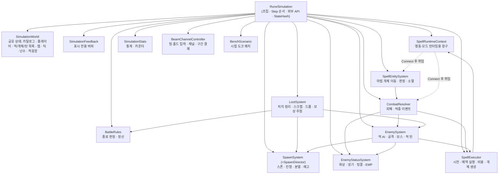
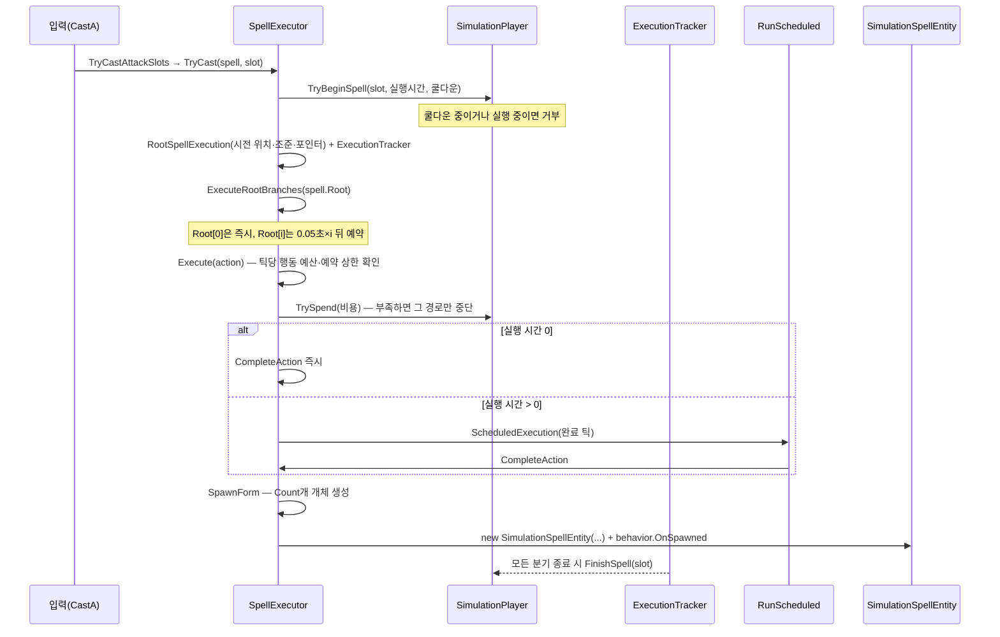
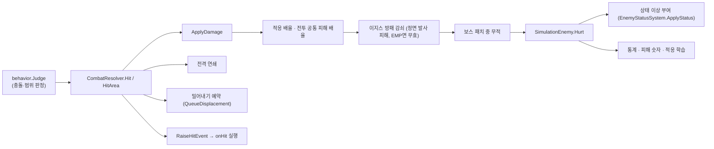

# 04. 전투 시뮬레이션

전투는 `RuneSimulation` 한 객체가 **60Hz 고정 틱, 결정적(deterministic)** 방식으로 진행한다. 같은 시드·같은 입력 순서라면 언제 어디서 돌려도 같은 결과가 나온다. 미션, 작업실 시험 도크, 명령행 시뮬레이션(CLI)이 모두 같은 클래스를 쓴다.

---

## 1. 설계 원칙

| 원칙 | 구현 |
|---|---|
| Unity와 분리 | `Core/Simulation`은 `UnityEngine`을 쓰지 않는다. 좌표는 `SimVector`(double), 입력은 `SimulationInput` 구조체 |
| 고정 시간 | 틱 길이 `STEP_SECONDS = 1/60`. 시간은 `Tick × STEP_SECONDS`로만 계산한다 |
| 결정적 난수 | 시뮬레이션 전체가 `SimulationWorld.Random`(mulberry32, `SimRandom`) 하나만 같은 순서로 쓴다 |
| 결정성 검증 | `RuneSimulation.StateHash()`가 핵심 상태를 문자열로 모아 FNV-1a 해시를 만든다 |
| 표시와 판정 분리 | 피해 숫자·연쇄 번개·빔 잔상 등 화면용 기록은 `SimulationFeedback`에만 쌓고 해시·판정에 쓰지 않는다 |
| 외부 계약 단일화 | 하위 시스템은 모두 `internal`. 외부는 `RuneSimulation`의 public 멤버만 쓴다 |

### 좌표계

- 시뮬레이션 좌표는 **픽셀 단위, 맵 왼쪽 위가 원점, y는 아래로 증가**한다.
- 타일 크기 32px(`sector1.json`). 미션 맵은 50×50 타일 = 1600×1600px, 외곽 벽만 있는 열린 맵(`MissionMap.CreateOpen`).
- 시험 도크 맵은 `sector1.json`의 `_benchTiles` 문자열 격자다.
- 화면 변환은 UI 쪽 `MissionWorldSpace`가 맡는다(월드 1 unit = 32px, 맵 중앙 원점, y 위로 증가).

---

## 2. 구성: `RuneSimulation`과 하위 시스템

`RuneSimulation`은 432줄의 **조립자(facade)**다. 생성자에서 하위 시스템을 만들고 참조를 연결하며, `Step`에서 정해진 순서로 호출한다. 실제 로직은 하위 시스템에 있다.



생성 순서(`RuneSimulation` 생성자)는 의존 순서를 따른다.

| 순서 | 객체 | 받는 참조 |
|---|---|---|
| 1 | `SimulationWorld` | `SimulationSetup`의 카탈로그·능력치, `new SimRandom(seed)`, `new AdaptationNet` |
| 2 | `SimulationFeedback` | world |
| 3 | `SpellRuntimeContext` | world, feedback |
| 4 | `SimulationStats` | — |
| 5 | `BeamChannelController` | world, stats |
| 6 | `SpellExecutor` | world, feedback, stats, beam, runtime |
| 7 | `EnemyStatusSystem` | world, stats, simulation(화상 피해 위임용) |
| 8 | `BattleRules` | world |
| 9 | `SpawnSystem` | world, feedback |
| 10 | `BenchScenario` | world, spawn |
| 11 | `EnemySystem` | world, feedback, stats, spawn, statuses, executor, simulation(벽 판정 위임용) |
| 12 | `LootSystem` | world, stats, statuses, rules, spawn, enemy, 스크랩 배율·회복·처치 전력 |
| 13 | `CombatResolver` | world, feedback, stats, statuses, enemy, executor, runes, runtime |
| 14 | `SpellEntitySystem` | world, combat, runtime |
| 15 | `runtime.Connect(combat, entities)` | 순환 참조를 생성 후 연결 |
| 16 | 미션이면 `BeginTimedBattle`, 아니면 `ResetBench("dummy_single")` | |

`EnemyStatusSystem`과 `EnemySystem`이 `RuneSimulation` 자신을 받는 이유는 생성 순서상 아직 없는 `CombatResolver`·`SpellEntitySystem`에 위임하기 위해서다(`ApplyDamage`, `FirstWallFraction`).

### 2.1 생성 설정: `SimulationSetup`

`SimulationSetup.FromGameData(...)`가 전역 `GameData`를 한 번 읽어 카탈로그와 전투 설정을 묶는다.

| 인자 | 미션(`MissionRun`) | 시험 도크(`DockRun`) | CLI |
|---|---|---|---|
| `seed` | `Environment.TickCount` (매번 다름) | 1 | 명령행 `--seed` |
| `isMission` | true | false | 시나리오가 `incremental`이면 true |
| `maxHp`, `maxEnergy`, `energyRegen` | 세션 파생 능력치 | 세션 파생 능력치 | 밸런스 기본값 |
| `stageNumber` | `session.SelectedStage` | 1 | `--stage` |
| 피해·이동·스크랩 배율, 처치 전력, 스크랩 회복 | 세션 파생 능력치 | 일부 | 기본값 |
| `carrier` | `GameData.Carrier` | `GameData.Carrier` | `GameData.Carrier` |

---

## 3. 틱 순서: `RuneSimulation.Step(SimulationInput)`

한 번 호출이 정확히 1틱이다. 전투가 끝났으면(`Completed` 또는 `IsFailed`) 아무것도 하지 않는다.

| # | 처리 | 담당 |
|---|---|---|
| 1 | 포인터 위치 저장, 빔 홀드·클릭 입력 기록 | `SpellExecutor.AimPoint`, `BeamChannelController.ReadBeamInput` |
| 2 | 조준 방향 갱신, 전력 회복·쿨다운·대시 시간 감소 | `SimulationPlayer.Aim`, `Advance` |
| 3 | 이동·대시 처리. 대시 시작/종료와 이동 입력에 따라 `onDashStart` / `onDashEnd` / `onMove` 트리거 시전 | `MovePlayer`, `SpellExecutor.TryCastTrigger` |
| 4 | (미션) 예고 스폰 진행 → 스폰 진행 → 분열 생성 → 예고 표시 갱신 | `SpawnSystem` |
| 5 | 이번 틱에 도달한 예약 실행 처리 | `SpellExecutor.RunScheduled` |
| 6 | 공격 입력이 있는 슬롯을 `onAttack` 트리거로 시전 | `SpellExecutor.TryCastAttackSlots` |
| 7 | 상태 이상 진행(화상 틱 피해, 만료) | `EnemyStatusSystem.AdvanceStatuses` |
| 8 | 릴레이 회복 오라 | `EnemySystem.AdvanceRelayRegen` |
| 9 | 적 이동·공격·보스 패턴 | `EnemySystem.AdvanceEnemies` |
| 10 | (미션) 적끼리 겹침 분리 | `EnemySystem.ApplySeparation` |
| 11 | 예약된 적 연사 발사 | `EnemySystem.RunEnemyShots` |
| 12 | 마법 개체 이동·판정·수명·소멸 | `SpellEntitySystem.AdvanceSpellEntities` |
| 13 | 정지된 빔 채널 제거 | `BeamChannelController.RemoveStoppedChannels` |
| 14 | 적 탄환 진행·플레이어 피격 | `EnemySystem.AdvanceHostileProjectiles` |
| 15 | 죽은 적 정리(처치 집계, 스크랩·드롭 생성, 분열 예약, 자폭) | `LootSystem.CleanupEnemies` |
| 16 | 스크랩 오브·룬 드롭 끌어당기기·줍기 | `LootSystem.CollectNearbyOrbs`, `CollectNearbyItemDrops` |
| 17 | (미션) 플레이어 체력 0이면 `Dead` + 미획득 스크랩 폐기 + 전투 취소. (도크) `adapt_loop` 더미 재생성 | |
| 18 | 적응 학습 감쇠 | `AdaptationNet.Advance` |
| 19 | **`Tick++`** | |
| 20 | 다음 틱 기준으로 예약 실행 한 번 더 처리 | `SpellExecutor.RunScheduled` |
| 21 | (미션 전투 중) 종료 판정 | `CheckBattleEnd` → `BattleRules.TryEndBattle` |
| 22 | 표시 버퍼·5초 DPS 샘플 정리 | `TrimFeedback` |

**이 순서를 바꾸면 결정성 해시와 체감 동작이 달라진다.** 순서를 바꾸는 작업은 `SimulationCli`로 기준 해시를 비교해야 한다(6 문서 5절).

### 3.1 입력: `SimulationInput`

| 필드 | 의미 |
|---|---|
| `Movement` | 이동 벡터(WASD). 길이가 1보다 크면 정규화 |
| `AimDirection` | 조준 방향 |
| `AimPoint` | 포인터 시뮬레이션 좌표(없으면 null). 범위 마법 배치에 쓴다 |
| `CastA/B/C` | 슬롯 0·1·2 공격 입력(누르고 있는 동안 참) |
| `CastPressed`, `CastReleased` | 이번 틱에 누름·뗌 (빔 홀드 판정) |
| `Dash` | 대시 입력 |
| `IsAutomatic` | 자동 시전(도크 자동 발사, CLI) |

---

## 4. 마법 실행 모델 (`SpellExecutor`)

### 4.1 시전에서 개체 생성까지



| 단계 | 핵심 규칙 |
|---|---|
| 시전 가능 조건 | 장착 마법 있음, 단계가 `Bench` 또는 `Combat`, 미션에서는 슬롯 0만, 슬롯 쿨다운 0이고 실행 중 아님 |
| 쿨다운 | 시전 즉시 `Cooldown + 예상 실행 시간`으로 시작. 공격 시작에 직접 연결된 빔은 슬롯 주기 틱 |
| 루트 분기 | 시작 노드에 연결된 행동이 여럿이면 첫 번째는 즉시, 나머지는 `ROOT_BRANCH_INTERVAL_SECONDS`(0.05초) 간격으로 예약 |
| 비용 결제 | 노드가 시작할 때 결제(`TrySpendFor`). 모든 자원이 충분할 때만 원자적으로 차감 |
| 실행 시간 | 노드 `ExecutionSeconds × ExecutionTimeScale`을 60Hz 틱으로 올림. 완료 시점에 효과 적용 |
| 효과 위치 | 직접 시전 경로는 **완료 순간의 지팡이 끝·조준 방향**을 다시 읽는다(`GetEffectContext`). 이벤트 경로는 사건 위치를 유지 |
| 한도 | 틱당 행동 `MaxActionsPerTick`(512), 예약 `MaxScheduledExecutions`(2048), 동시 개체 `MaxLiveSpellEntities`(128). 넘으면 버리고 `DroppedExecutions` 증가 |
| 완료 추적 | `ExecutionTracker`가 대기 작업 수를 세다가 0이 되면 `FinishSpell(slot)`. 이 시점까지 같은 슬롯은 다시 시전되지 않는다 |

### 4.2 `SpawnForm`: 개체 생성 세부

1. 첫 회차(`wave == 0`)이면 부착 노드 실행 기록, 폭발에 장착한 다중의 남은 회차를 `WaveInterval` 간격으로 예약.
2. 속성 결정: 노이즈면 해금 속성 중 결정적 난수로 하나(같은 루트 시전에서 공유), 아니면 `action.Element`.
3. `SpellStats` 적용, 행동 런타임·동작 모드 런타임 조회.
4. 빔이면 `BeamChannel`을 만들어 `BeamChannelController`에 등록.
5. `Count`개만큼 반복:
   - 위치·방향 = 문맥의 원점·방향 (참격 직접 시전은 시전자 조준 방향)
   - **배치 순서: 동작 모드 `BeforePlaceSpawn` → 행동 `PlaceSpawn` → 동작 모드 `AfterPlaceSpawn`**
   - 직접 시전한 지면 범위(잔류)이고 포인터가 있으면 포인터 위치(최대 배치 사거리 240px 제한)로 덮어씀(`AreaTargeting`)
   - `new SimulationSpellEntity(...)`, 통계 기록, 목록 추가, `behavior.OnSpawned`

### 4.3 문맥 객체

| 타입 | 역할 |
|---|---|
| `SpellContext` (struct) | 원점, 방향, 대상 적, 이벤트 유래 여부, 노이즈 속성, 수치 배율, 비용 배율, 시전자, 이벤트 원본 개체 ID, onHit 선결제 여부. 예약 시 그대로 복사돼 보관된다 |
| `RootSpellExecution` | 슬롯·마법·슬롯 주기·시전 시점 플레이어 위치·조준·포인터. 빔 구간 비용 보관 |
| `ExecutionTracker` | 분기·예약 대기 수 카운터와 완료 콜백 |
| `ScheduledExecution` (struct) | 목표 틱, 행동, 문맥, 추적기, 루트 분기 시작 여부, 폭발에 장착한 다중의 회차 번호 |
| `SpellRandomState` | 같은 루트 시전 안에서 노이즈 속성 공유 |

### 4.4 이벤트 연쇄 (onHit)

개체가 적에게 맞으면 `CombatResolver.RaiseHitEvent`가 새 `SpellContext`(접촉 위치, 접촉점→대상 방향, 대상 적, `fromEvent=true`, onHit 선결제)를 만들어 `SpellExecutor.Execute(action.OnHit, context)`를 호출한다. 이벤트 경로는 슬롯과 분리된 추적기를 쓰므로 슬롯 실행 잠금에 영향을 주지 않는다. 발사처럼 직접 충돌을 추적하는 행동은 첫 이벤트에 `OnFirstHitOrExpire`도 실행하고, 직접 충돌한 개체는 소멸 이벤트를 내지 않는다.

### 4.5 빔 채널

빔은 다른 행동과 달리 **입력을 누르고 있는 동안 유지**된다.

- `BeamChannelController`가 슬롯별 홀드·짧은 클릭 예약을 기록한다.
- 공격 시작에 직접 연결된 빔(`IsSlotCycleBeam`)은 슬롯 주기마다 구간 비용을 결제하고 채널을 연장(`Renew`)한다. 결제에 실패하면 채널을 멈춘다.
- 과충전 모드는 유지 시간에 따라 피해·폭·전력 배율을 키운다.
- 장착 변경, 전투 종료, 일시정지 등에서 `CancelBeamChannels` / `CancelBeamInput`으로 정리한다.

---

## 5. 마법 개체 (`SimulationSpellEntity`, `SpellEntitySystem`)

### 5.1 개체가 가진 것

ID, 원본 `SpellAction`, `SpellStats`, 속성, 위치·이전 위치·방향, 나이·수명, 적중 수, 대상별 마지막 타격 시각(`HitTimes`), 소멸·첫 이벤트·직접 충돌 플래그, 행동 런타임과 **행동 상태 객체**, 동작 모드 런타임 배열과 **모드 상태 객체 배열**, 시전자.

`Radius`, `BoxLength`, `IsWarning` 같은 값은 행동 런타임에 물어 계산한다(예: 폭발은 확장 시간 동안 반경이 0에서 커진다).

### 5.2 매 틱 처리 (`AdvanceSpellEntities`)

```
for each entity (이번 틱 시작 시점의 개수만큼):
    MarkPreviousPosition()
    if (!entity.MoveByModifiers(runtime))      // 이동 모드를 우선순위 순으로 TryMove, 처음 true인 모드만 이동
        behavior.MoveAlongPath(runtime, entity) // 이동 모드가 안 맡으면 행동 기본 경로
    behavior.Judge(runtime, entity)              // 이번 틱 이동 구간으로 판정(스윕·범위)
    entity.Advance(1/60)                          // 나이 증가
    behavior.AfterAdvance(runtime, entity)
    if (소멸 플래그 && RemovesWhenExpired) || 나이 >= 수명:
        Expire(entity)  // 자연 소멸이면 OnExpire 이벤트 (행동이 허용할 때, 직접 충돌 개체 제외)
        제거
```

이동을 맡지 못한 이동 모드는 `UpdatePassive`로 상태만 갱신한다(예: 공전 궤도 자리는 계속 회전).

### 5.3 행동별 실행 동작 (`Core/Simulation/Behaviors/`)

| 런타임 | Kind | 동작 |
|---|---|---|
| `LaunchBehaviorRuntime` | `bolt` | 매 틱 직진. 벽 → 원형 쉴드 → 적 순서로 판정. 적에 맞으면 기본 소멸(관통 모드가 바꿈) |
| `BurstBehaviorRuntime` (Launch 상속) | `burst` | 생성 위치를 중심으로 확장하는 원형 파동. 벽·보호막 통과, 적마다 한 번 피해·바깥 방향 밀어내기·OnHit. 적중으로 소멸하지 않음 |
| `PersistBehaviorRuntime` | `zone` | 예고 시간 뒤 `TickInterval`마다 지속 피해. 대상별 첫 타격과 이후 두 타격마다 OnHit. 기본 제자리 |
| `BeamBehaviorRuntime` | `beam` | 지팡이 끝에서 벽을 통과하는 중심선 경로를 매 틱 다시 그림. 이동 모드가 경로 칸 방향을 고침(`SteerPathStep`). 채널이 수명을 관리 |
| `SlashBehaviorRuntime` | `slash` | 시전자(또는 후속 대상) 중심을 따라 오른쪽→왼쪽으로 회전하는 칼날. 구간 샘플링으로 대상별 1회 피해 |

### 5.4 동작 모드 실행 (`Core/Simulation/Modifiers/`)

| 런타임 | 개입 시점 | 동작 |
|---|---|---|
| `MultiModifierRuntime` | 배치 | 지팡이 앞: 퍼짐 각도 안 등간격 방향. 지면: 생성 지점 주위 원형 배치. 참격: 원을 개수로 등분 |
| `HomingModifierRuntime` | 이동 (우선) | 발사: 범위 안 가장 가까운 미적중 적으로 회전각만큼 회전. 잔류: 예고 후 가까운 적으로 이동. 빔: 경로 칸마다 대상 쪽으로 굴절. 공전 위에서는 진입 후 대상에 직선 돌진 |
| `OrbitModifierRuntime` | 이동 | 기준점(직접 시전은 시전자, 이벤트는 이벤트 위치) 주위를 반시계로 공전. 진입·궤도 중 벽 무시 |
| `PierceModifierRuntime` | 적중 | 적중마다 피해에 유지 배율을 곱하고 관통 수까지 소멸하지 않음 |
| `BeamEmpowerModifierRuntime` | 적중 | 빔 과충전 |

### 5.5 `SpellRuntimeContext`

행동·모드 런타임은 `RuneSimulation`을 직접 받지 않고 이 창구만 받는다. 제공 기능: 틱·시간·적 목록·맵·플레이어·밸런스 읽기, `HitArea`, `Hit`, `RaiseHitEvent`, `RaiseShieldHitEvent`, `RecordBeamFlash`, `FirstWallFraction`, `NearestEnemy`. 판정 함수는 `CombatResolver`·`SpellEntitySystem`에 위임한다.

---

## 6. 피해와 상태 이상

### 6.1 피해 적용 경로



- 관통 직접 피해는 보정 후에도 최소 1을 유지한다.
- 밀어내기는 같은 틱에 여러 번 예약되면 벡터를 합산하고, 다음 틱부터 적용한다(`SimulationEnemy.QueueDisplacement` / `TryAdvanceDisplacement`).
- 행동별 실제 피해와 OnHit 횟수는 `SimulationStats.GetActionCombatStats(action)`에 쌓여 전투 로그(`GetActionCombatLogSnapshot`)로 나간다.

### 6.2 상태 이상 (`EnemyStatusSystem`)

| 종류 | 부여 | 효과 | 수치 (`balance.json _combat`) |
|---|---|---|---|
| Burn 화상 | 화염 속성 피해 | 0.5초마다 원 공격 피해의 15% 지속 피해. 재점화는 더 큰 피해일 때만 피해·출처 교체, 지속시간은 갱신, 틱 일정 유지 | `_burnDamageRatio`, `_burnInterval`, `_burnSeconds` |
| Chill 냉기 | 냉기 속성 피해 | 스택마다 감속. 최대 스택이면 빙결로 전환 | `_chillSlow`, `_chillSeconds`, `_chillMaxStacks` |
| Freeze 빙결 | 냉기 최대 스택 | 행동 정지, 이후 면역 시간(면역 중 냉기 스택 상한 2) | `_freezeSeconds`, `_freezeImmunity`, `_chillImmuneMaxStacks` |
| Emp | 전격 속성 피해(내부 태그 `arc`) | 지속 시간 동안 이지스 방패 감쇠를 무력화 | `_empSeconds` |

속성 문자열은 런타임 태그 기준이다: 화염 `fire`, 냉기 `ice`, 전격 `arc`(`EnemyStatusSystem.ApplyStatus`).

화염 강화 중에는 화상 부여마다 그 틱 피해를 중첩에 저장하고, `_burnMaxStacks`(3)에 도달하면 저장값 합에 `_burnBurstMultiplier`(6)를 곱한 `burn_burst` 피해를 한 번 준 뒤 적의 상태 이상을 모두 지운다.

상태 이상은 적 ID와 종류를 합친 키로 인덱싱되며, 적이 제거되면 함께 지운다.

### 6.3 적응(AdaptationNet)

적이 같은 속성·형태로 계속 맞으면 학습값이 오르고 그 조합의 피해가 줄어든다. **현재 미션에서는 꺼져 있고**(`BeginTimedBattle`에서 `SetEnabled(false)`), 시험 도크의 적응 옵션과 `adapt_loop` 시나리오에서만 쓴다.

---

## 7. 적 (`EnemySystem`, `EnemyMovement`, `EnemySeparation`)

### 7.1 적 상태: `SimulationEnemy`

공유 정의(`EnemyDefinition`, `BossDefinition`)를 바꾸지 않고, 개체별 체력·피해 배율·속도 배율·보상·엘리트 정의·공격 예약 시각·예고·돌진·보스 페이즈·강제 이동·캐리어 정보를 따로 보관한다. 엘리트는 반경 배율을 곱한 크기로 판정·표시한다.

### 7.2 매 틱 적 처리 (`AdvanceEnemies`)

1. 이동 전 플레이어까지 거리·방향을 계산한다.
2. 강제 이동(밀어내기)을 먼저 진행한다. 진행 중이면 이번 틱 자발 이동을 보류할 수 있다.
3. `EnemyMovement`가 이동 종류별 판단(정지·방향 전환·이동)을 돌려주고, 냉기 감속과 벽 충돌을 반영해 이동한다.
4. 공격 일정을 이동 **전** 거리·방향으로 진행하고, 접촉·발사 위치는 이동 **후** 위치를 쓴다.
5. 보스는 페이즈(체력 비율 0.67/0.34)에 따라 방사 사격·조준 사격·예고 장판·증원을 진행한다. 페이즈 전환 시 일정 시간 무적(패치)이며, 패치 때 가장 많이 맞은 속성·형태를 적응 상한에 고정한다.

히드라의 목 뻗기는 0.75초 예고 → 0.25초 확장 → 최대 길이를 유지하며 1.9초 동안 몸체와 목 90도 회전 → 0.1초 회수 순서로 진행한다. 회전각은 `_stretchRotationDegrees`로 설정한다. 회전 중 각 목은 해당 방향의 벽까지 길이를 갱신하며, 목의 표시와 피해 판정은 같은 회전각·끝점을 사용한다. 확장·회전·회수 중에는 목 피해 판정이 유지된다.

히드라의 목 5개 회전 돌진은 0.9초 동안 목을 길이 230까지 확장하면서 돌진 전체 공격 영역을 직사각형으로 예고한다. 확장 시작 시 플레이어 방향을 고정하며, 몸체 지름의 5배(기본 520)를 0.6초 동안 한 번 돌진한다. 목은 0.1초당 한 바퀴로 빠르게 회전하지만 피해 판정은 목 사이의 빈틈 없는 직사각형을 사용한다. 직사각형의 반너비·반길이는 몸체 반경과 목 길이+목 반두께 중 큰 값(기본 241)이며, 기본 예고는 폭 482·길이 1002다. 범위 표시는 준비 중에만 보이고 돌진 시작 시 숨긴다. 돌진 중에는 현재 몸체를 중심으로 한 같은 크기의 직사각형을 이동 경로 전체에 연속 판정한다. 몸체는 첫 벽 앞에서 멈추고 바로 0.25초 회수에 들어가며, 목의 표시는 벽까지 길이가 제한된다. 준비·회수 중에는 몸체와 목의 피해가 없고, 돌진 중에는 공격당 최대 한 번 기본 피해 18을 준다. 대시·피격 무적 중 접촉은 이 한 번의 피해 기회를 소모하지 않는다. 회수 후 공통 쿨타임 1.3초로 이어진다.

히드라의 독은 패턴당 구체 1발을 발사한다. 몸체 앞에서 구체가 1초간 성장하며, 첫 0.5초는 플레이어 방향을 추적하고 나머지 0.5초는 방향을 고정해 첫 벽까지의 발사 경로를 예고한다. 발사 후 속도 900·반경 36으로 직선 이동한다. 벽에 닿을 때마다 현재 플레이어 위치를 다시 조준하고, 70% 확률로 좌우 중 무작위 방향에 0~15도 오차를 더한다. 나머지 30%는 각도 오차를 더하지 않는다. 벽 안쪽을 향하거나 모서리에서 즉시 벽에 겹치는 방향은 법선으로 보정하거나 물리 반사 방향으로 대체하며 속력은 유지한다. 빗나감 확률과 각도 범위는 `bosses.json`의 `_poisonBounceMissChance`·`_poisonBounceMinOffsetDegrees`·`_poisonBounceMaxOffsetDegrees`로 조정한다. 수명은 발사 후 최대 5초이며 시간 만료 시에는 장판 없이 소멸한다. 발사 직후 히드라는 공통 쿨타임 1.3초를 거쳐 다음 패턴을 진행한다.

독 구체는 대시·피격 무적 중인 플레이어와 접촉하면 피해·소멸·장판 생성 없이 통과한다. 무적이 아닌 플레이어에게 닿으면 기본 피해 14를 주고 접촉 위치에 반경 85·지속 6초의 독 장판으로 전환한다. 장판은 생성 0.75초 뒤부터 0.75초마다 기본 피해 6을 주며 기존 피격 무적을 따른다. 전투 종료 시 구체·준비 표시·장판을 정리한다.

| 이동 종류 | 동작 |
|---|---|
| `chase` | 플레이어 추적 |
| `turret`, `anchor` | 미션에서는 공용 전진 속도로 다가옴, 도크에서는 방향만 바꾸거나 정지 |
| `dashChase` | 예고 후 고정 방향 돌진 |
| `keepDistance` | 유지 거리 밖이면 추적, 안이면 방향만 |
| `sniper` | 조준·고정 대기 중 정지 |
| `interceptor` | 이동·정지 주기, 정지할 때마다 한 발 |

| 공격 종류 | 동작 |
|---|---|
| `contact` | 주기적 접촉 피해 |
| `burst` | 예고 후 부채꼴 연사(첫 발 즉시, 나머지 예약) |
| `dashContact` | 예고 후 돌진 중 접촉 |
| `sniper` | 추적 조준 → 고정 → 단발. 표시와 사격이 같은 저장 경로 사용 |
| `interceptor` | 이동 종료마다 플레이어 방향 한 발 |
| `none` | 공격 없음 |

| 특성 | 동작 |
|---|---|
| `aegisShield` | 정면 각도(120°)로 들어온 발사(`bolt`) 직접 피해 70% 감쇠. EMP 상태면 무효 |
| `relayAura` | 60틱마다 반경 200 안 다른 적 회복 |
| `deathExplosion` | 처치 시 자폭 |
| `circleShield` | 최대 체력 7배의 원형 보호막. 발사체가 먼저 맞음 |
| `carrier` | 캐리어 설정(Prefab)에 따라 주변에 보상 없는 자식 생성 |

### 7.3 적 분리

`EnemySeparation`은 공간 격자로 겹친 적 쌍을 찾아 반경 비율로 밀어낸다. 모든 밀림을 누적한 뒤 한꺼번에 적용(야코비 방식)하므로 목록 순서에 결과가 좌우되지 않는다. 보스·빙결·돌진 중인 적은 고정점으로 취급한다. 격자는 전투 시작 시 한 번 크기를 정하고 틱마다 새로 할당하지 않는다.

### 7.4 플레이어 피격

`SimulationPlayer.Hurt`는 무적 시간(대시 중, 피격 후 0.5초)을 확인하고 보호막 → 체력 순으로 피해를 적용한다. 상태 이상 피해(`HurtByStatus`)는 무적을 무시하고 새 무적도 주지 않는다. 디버그 무적은 `SimulationWorld.DebugInvulnerable`.

---

## 8. 스폰 (`SpawnSystem`, `SpawnDirector`, `SpawnFormation`)

### 8.1 스폰 진행기: `SpawnDirector`

연속 미션 웨이브 하나를 커서로 진행한다. 웨이브 시작 틱부터 편성 `_units`를 진형 주기(`_interval`) 간격으로 한 기씩 내주며, 미리 전체 목록을 만들지 않고 `TryPeek`가 현재 틱까지 도달한 다음 스폰을 하나씩 내준다. `_isElite` 유닛은 현재 스테이지의 `_eliteTypes` 정의로 생성한다. 모든 유닛을 내고 남은 적이 없으면 다음 웨이브로 넘어간다.

### 8.2 배치

| 방식 | 처리 |
|---|---|
| 원형 슬롯 진형 | 플레이어 중심 스폰 링(반경 = 기본 볼트 사거리 + 가장 큰 적 반경 + 여유) 위 20개 슬롯 중 맵 안 슬롯을 골라 배치. 진형 모양에 따라 전체·절반·이중·구역·한 점 연속 등 |
| 맵형 진형 | 맵 전체에서 플레이어 거리 띠(240~650px) 안, 벽·다른 예고와 겹치지 않는 위치를 고름. **예고(0.8초) 뒤 생성**하고 예고 표시(`SpawnWarnings`)를 남김 |
| 분열 | 분열형 적이 미션 중 죽으면 자식 수만큼 대기 항목 생성(진행 방향 수직선 위 균등 배치, 엘리트 정의 상속) |
| 보스 증원 | 보스 주변 원 위에 등간격 |
| 상한 | 살아 있는 적 + 예고 대기 수가 `MaxEnemies`(300)면 이번 틱 처리를 멈추고 다음 틱에 재시도 |

스폰 직후 적은 `_spawnGraceSeconds`(0.3초) 동안 접촉 피해를 주지 않는다.

---

## 9. 전투 종료와 보상

### 9.1 종료 조건 (`BattleRules.IsProgressionWaveFinished`)

| 웨이브 | 종료 | 실패 |
|---|---|---|
| 일반 | 편성을 모두 내고 맵의 적을 전부 처치 | 체력 0 → `Dead` |
| 보스(6라운드 마지막) | 보스 처치 | 체력 0 → `Dead` |

라운드의 마지막 웨이브가 끝나면 `RoundBreak`(라운드 대기), 3스테이지 6라운드가 끝나면 `Cleared`가 된다. 같은 틱에 사망과 종료가 겹치면 사망 판정이 `Step` 안에서 먼저 일어난다.

### 9.2 전리품 (`LootSystem`)

| 항목 | 규칙 |
|---|---|
| 스크랩 오브 | 처치 시 `보상 × 스크랩 획득 배율`(소수점은 다음 드롭으로 이월). 엘리트·보스는 대형 스크랩 |
| 처치 전력 회복 | `floor(드롭 크레딧 × 0.3)`(최소 1) + 트리 보너스 |
| 줍기 | 줍기 반경(80 × 배율) 안이면 끌어당겨(480px/s) 도착 시 획득. 획득량 × 회복 비율만큼 체력 회복 |
| 룬 드롭 | 엘리트는 엘리트 정의의 드롭 확률, 일반 적은 스테이지 일반 드롭 확률로 1회 판정 → `drops.json` 테이블에서 분류(속성·행동·모드)·종류·등급 추첨. 캐리어 자식은 드롭 없음 |
| 클리어 | 남은 스크랩·룬을 모두 회수하고, 화면 연출용으로 위치를 `ClearOrbs`/`ClearItemDrops`에 보존 |
| 실패 | 미획득 스크랩 폐기 |

### 9.3 정산 값

| 결과 | 지급 스크랩 | 코드 |
|---|---|---|
| 클리어 | 회수한 스크랩 | `BattleRules.GetSettlementFragments` |
| 사망 | 회수한 스크랩 × 0.7 (반올림) | 같은 메서드 |
| 후퇴(중단) | 획득 스크랩 × 0.7 (반올림) | `MissionRun.AbandonMission` |

추가 보상(클리어 보장 룬 1개, 첫 클리어 룬, 보스 첫 클리어 모드 선택 3택 1)은 `MissionRun.FinishMission`이 처리한다(6 문서 1.4절).

---

## 10. 시험 도크 (Bench) 모드

`isMission=false`로 만든 시뮬레이션이다.

| 차이점 | 내용 |
|---|---|
| 맵 | `sector1.json`의 `_benchTiles` |
| 단계 | `MissionStage.Bench`. 종료 판정 없음 |
| 슬롯 | 시뮬레이션은 3슬롯을 지원하지만 `DockRun.ApplyLoadout`은 슬롯 0에만 현재 마법을 넣는다 |
| 시나리오 | `BenchScenario`: `dummy_single`(더미 1), `dummy_line`(일렬 1~5마리, 체력 10000, 작업실 도크가 쓰는 값), `dummy_swarm`(정찰병 격자), `aegis`(이지스 1), `adapt_loop`(적응 학습, 적이 없으면 재생성) |
| 초기화 | `ResetBench(scenario, dummyCount)`가 틱·개체 ID·난수를 처음으로 되돌리고 모든 목록을 비운다 |
| 상태 이상 피해 | 시전자 화상 피해는 표시만 하고 체력을 깎지 않는다 |
| 적 이동 | 고정형 적은 방향만 바꾸거나 정지 |

---

## 11. 외부에 노출되는 읽기 전용 데이터

UI와 Features가 읽는 `RuneSimulation`의 주요 공개 멤버를 용도별로 정리한다.

| 용도 | 멤버 |
|---|---|
| 월드 표시 | `Player`, `Enemies`, `SpellEntities`, `EnemyProjectiles`, `Orbs`, `ItemDrops`, `Map`, `MapCenter` |
| 표시 전용 효과 | `DamageNumbers`, `ArcLinks`, `HealPulses`, `BeamFlashes`(+`BeamFlashGeneration`), `SpawnWarnings`, `NodeEvents`, `ClearOrbs`, `ClearItemDrops` |
| HUD | `Tick`, `Time`, `StageNumber`, `RoundNumber`, `WaveNumber`, `RemainingWaveEnemyCount`, `IsBossStage`, `KillCount`, `EarnedFragments`, `SpawnedEnemies`, `Loadout` |
| 상태 | `Stage`, `Completed`, `IsDead`, `IsTimedOut`, `IsFailed`, `HasAnyActiveBeam` |
| 사운드 트리거(누적 카운터) | `EnemyDamageEventCount`, `ShotLaunch/Burst/Persist/SlashEventCount`, `BurnTickDamageEventCount`, `ArcDamageEventCount`, `FreezeStartEventCount`, 스크랩 줍기·생성 카운트 |
| 통계·정산 | `TotalDamage`, `StatusDamage`, `PersistDamage`, `RollingDps`, `EnergySpent`, `SettlementFragments`, `KillCounts`, `GetActionCombatLogSnapshot()` |
| 범위 미리보기 | `IsAreaPreviewAction`, `CanShowAreaPreview`, `GetRangePreview`, `GetAreaTargetPosition`, `GetAreaPlacementRange` |
| 적 표시 보조 | `HasEnemyStatus`, `GetChillStacks`, `GetSniperEnd` |
| 조작 | `Step`, `SetLoadout`, `SetUnlockedElements`, `TryCast`, `CancelBeamInput`, `CancelPendingSpellExecutions`, `TakeNewPickedItems`, `ResetBench`, `SetAdaptationEnabled` |
| 보상 추첨 | `DrawClearRuneReward`, `TryDrawClearModifierChoices` |
| 디버그 | `SetDebugInvulnerable`, `DebugSpawn`, `DebugDefeatRoom`, `StateHash` |

사운드는 "이벤트 콜백"이 아니라 **누적 카운터 비교**로 재생한다. Presenter·DockRun이 지난 프레임 값을 기억했다가 증가분만큼 효과음을 낸다. 시뮬레이션이 UI·사운드를 전혀 모르게 하려는 설계다.
