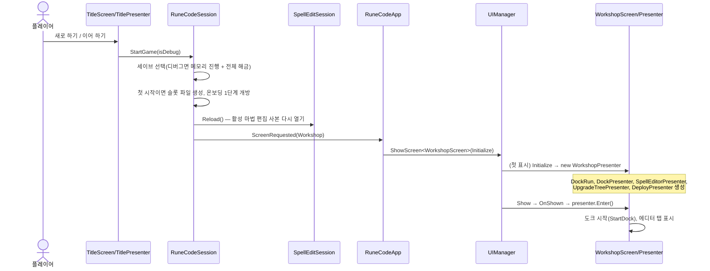
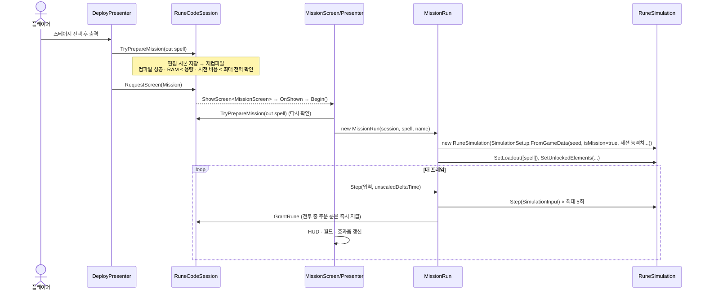
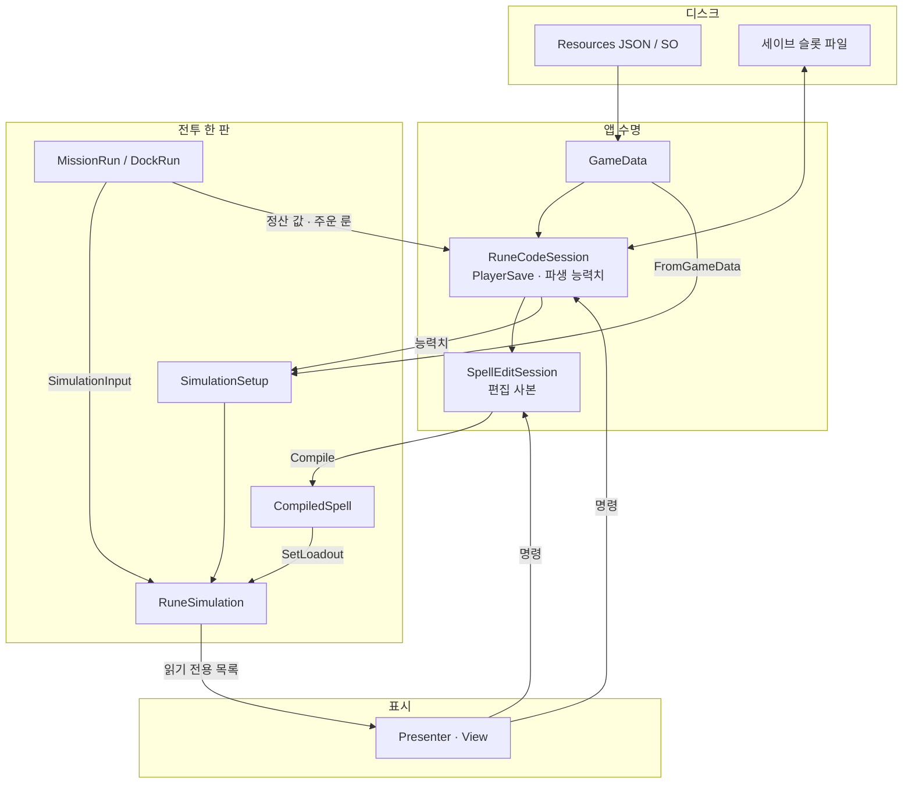

# 06. 실행 흐름, 확장 절차, 검증 도구

앞 문서들이 "구조"를 설명했다면, 이 문서는 **실제로 한 번 플레이할 때 어떤 코드가 어떤 순서로 불리는지**와 **새 기능을 추가할 때 손대야 할 곳**을 정리한다.

---

## 1. 시나리오별 실행 흐름

### 1.1 게임 시작 → 작업실



### 1.2 마법 편집 → 시험 도크

1. 팔레트에서 행동을 끌어 놓으면 `SpellPalettePresenter` → `ISpellEditor.AddRune(runeId, x, y, grade)`.
   - 행동 룬인지, 등급이 유효한지, 노드 한도, **이 프리셋의 소지량**을 검사한다.
2. 시작 노드의 `exec`에서 행동의 `exec`로 드래그하면 `RuneGraphCanvas` → `ISpellEditor.Connect(...)`.
   - 후보 그래프로 포트 규칙(`GraphCompiler.CanConnect`)과 RAM을 검사한다.
3. 속성·모드를 행동 노드 슬롯에 놓으면 `ISpellEditor.Equip(nodeId, slotKey, runeId, grade)`.
4. 각 변경은 Undo 스냅샷을 남기고 0.2초 뒤 `Recompile()` → `Save()`.
5. `Compiled` 이벤트로 인스펙터 오류 목록, 작업실 헤더, **도크 장착 마법**이 갱신된다.
6. 도크에서 좌클릭(또는 시험 버튼, `1` 키, 자동 발사)하면 `DockPresenter` → `DockRun.Step(aim, fire, ...)` → 도크 `RuneSimulation.Step` 반복.
7. 도크의 노드 실행 기록이 그래프에 하이라이트된다.

### 1.3 출격 → 전투



**전투 중 주운 룬은 즉시 세이브에 지급된다.** 사망하거나 후퇴해도 잃지 않는다. 스크랩만 정산 시점에 반영된다.

### 1.4 전투 종료 → 정산 → 결과

`MissionRun.Step`이 `Completed || IsFailed`를 보면 `FinishMission()`을 한 번 호출한다.

| 순서 | 처리 | 코드 |
|---|---|---|
| 1 | 첫 클리어 여부 판정(정산 전에) | `session.HighestClearedStage < StageNumber` |
| 2 | 정산 스크랩 계산 | `RuneSimulation.SettlementFragments` |
| 3 | 클리어면 보장 룬 1개 추첨 | `RuneSimulation.DrawClearRuneReward` |
| 4 | 세션 정산: 스테이지 클리어 룬 보상 지급, 보장 룬 지급, 클리어 기록, 온보딩 개방, 스크랩 반영, 처치 기록, 저장 | `RuneCodeSession.SettleMission` |
| 5 | 패배면 첫 패배 온보딩 이벤트 | `TryTriggerOnboardingEvent` |
| 6 | 결과 문구·보상 목록 작성 | `_lastResult`, `_rewards` |
| 7 | 보스 첫 클리어면 모드 선택 후보 3개 추첨 | `TryDrawClearModifierChoices` |
| 8 | 사용성 로그 마감 | `LocalTelemetry.EndUsabilityCombat` |

이후 `MissionPresenter`가 종료 연출 → `ResultPanel` 표시 → 보상 순차 공개 → (보스 첫 클리어면) 선택 카드를 띄운다. 선택하면 `MissionRun.ChooseClearModifier` → `session.GrantModifier`.

| 결과 버튼 | 동작 |
|---|---|
| 마법 강화 | `RequestScreen(Workshop)` |
| 다음 스테이지 | `SelectStage(n+1)` 후 작업실의 스테이지 선택 영역을 열도록 표시하고 `RequestScreen(Workshop)` |
| 재도전 | `SelectStage(n)` 후 `StartRun()` (같은 화면에서 새 `MissionRun`) |

보스 선택 보상이 남아 있으면 세 버튼 모두 선택 전까지 무시된다. 테스트 모드(`IsTestMode`)에서는 스크랩·룬 보상을 세이브에 반영하지 않는다.

### 1.5 후퇴

일시정지 팝업의 후퇴 → `MissionRun.AbandonMission()`: 예약 실행 취소, `EarnedFragments × 0.7` 반올림 정산, 클리어 아님으로 `SettleMission`, 사용성 로그 `retreat`.

### 1.6 강화 트리 구매

`UpgradeTreePresenter` → `RuneCodeSession.BuyUpgradeNode(nodeId)`:
요구 스테이지·선행 노드·재화 확인(`CanPurchaseUpgradeNode`) → 스크랩 차감 → 노드 레벨 +1 → 룬 해금 노드면 `Unlock(runeId)` → `PersistProgress` → **`_spells.Recompile()`**(해금·용량이 바뀌었으니 컴파일 결과 갱신) → `WorkshopPresenter.RefreshProgression`이 도크 재시작·헤더 갱신.

능력치는 저장하지 않고 매번 트리 SO × 세이브 레벨로 계산하므로(02 문서 5.2절), 구매 직후 다음 도크·미션 생성부터 반영된다.

---

## 2. 데이터 흐름 요약도



---

## 3. 확장 절차

### 3.1 새 행동(Behavior) 추가

1. **데이터**: `tables/runes.json`에
   - 플레이어용 행동 룬 `behavior.{name}`(category `behavior`, 포트 `exec`(in)·`onHit`(out), RAM, 해금 방식, `_shape`)
   - 수치 룬 `form.{Kind}`(category `internal`, `_stats`, 비용)
   을 추가한다. 모드를 붙일 수 있게 하려면 각 `mod.*`의 `_modifierTargets`에 새 행동 룬 ID를 넣는다.
2. **컴파일 규칙**: `Core/Graph/Behaviors/{Name}BehaviorRules.cs`를 `SpellBehaviorRules` 상속으로 만들고 `RuneId`, `FormValue`, `Kind`와 필요 시 `DisplayType`, `SpawnOrigin`, `MotionKind`, `GetLifetime`, `TryGetMaxHitEvents`를 정의한다. `SpellBehaviorRuleRegistry.RULES`에 한 줄 추가.
3. **실행 동작**: `Core/Simulation/Behaviors/{Name}BehaviorRuntime.cs`를 `SpellBehaviorRuntime` 상속으로 만들고 같은 `Kind`를 반환한다. `PlaceSpawn`, `CreateState`, `MoveAlongPath`, `Judge`, `GetRadius` 등 필요한 것만 재정의한다. 상태가 있으면 `WriteState`로 해시에 기록한다. `SpellBehaviorRuntimeRegistry.RUNTIMES`에 한 줄 추가.
4. **표시**: 새 `SpellDisplayType`이 필요하면 열거형에 추가하고 `SpellEntityView`(미션)와 `RuneArenaGraphic`(도크)에 그리기 분기를 추가한다.
5. **문구**: `strings.ko.json`에 `rune.{id}.desc` 등 설명 키 추가(`RuneDescriptionBuilder`가 사용).
6. **검증**: 부팅 시 `GameData.ValidateBehaviorRegistries`가 등록 누락을 잡는다. `GameData.Load`는 `form.beam`, `form.burst`, `form.slash` 수치를 따로 검사하므로 새 행동에 필수 수치가 있으면 같은 방식으로 검사를 추가할 수 있다.

### 3.2 새 동작 모드(Modifier) 추가

- **수치만 바꾸는 모드**(피해·크기·속도·지속·비용류): 클래스가 필요 없다. `runes.json`에 `mod.*` 룬을 추가하고 `elite_modifier_drops.json`에 효과 타입·등급 값을 추가한다. 새 효과 타입이면 `ModifierGradeTable`의 효과 상수와 `SpellModifierValues`/`SpellStats` 적용 코드, `RuneDescriptionBuilder` 설명 분기를 추가한다.
- **동작을 바꾸는 모드**(배치·이동·적중 개입):
  1. `Core/Graph/Modifiers/{Name}ModifierRules.cs` (`SpellModifierRules` 상속: `RuneId`, `Category`, 필요 시 `MotionPriority`, `CanAttachTo`, `ModifyCount` 등) → `SpellModifierRuleRegistry.RULES`에 추가.
  2. `Core/Simulation/Modifiers/{Name}ModifierRuntime.cs` (`SpellModifierRuntime` 상속: 배치는 `Before/AfterPlaceSpawn`, 이동은 `TryMove`/`UpdatePassive`/`SteerPathStep`, 적중은 `OnHit`) → `SpellModifierRuntimeRegistry.RUNTIMES`에 추가.
  3. 레지스트리 **등록 순서**가 이동 모드 실행 순서와 개체 모드 상태 순서가 되므로, 기존 순서를 바꾸면 결정성 해시가 달라진다. 새 항목은 끝에 추가하는 것이 안전하다.
  4. 데이터(`runes.json`, `elite_modifier_drops.json`)와 문구를 추가한다.

### 3.3 새 적 추가

1. `enemies.json`에 행 추가(이동·공격·특성은 기존 문자열 중 선택).
2. 새 이동·공격 방식이면 `EnemyDefinition`의 상수, `EnemyMovement`의 판단 분기, `EnemySystem`의 공격 분기를 추가한다. 상태가 늘면 `SimulationEnemy.WriteState`에 기록한다.
3. 외형이 필요하면 `Resources/RuneCode/enemies/{Name}.prefab`(`EnemyView`의 `EnemyId` 설정)을 만든다. 없으면 기본 `MissionEnemy.prefab`으로 그린다.
4. `stages.json`의 `_progressionStages[]._rounds[]._waves[]._units`에 넣어 등장시킨다. 처치 보상 덮어쓰기는 `_rewards`.

### 3.4 새 스테이지·편성 조정

메뉴 `Rune Code/Stage Table Editor`(`Editor/StageTableEditorWindow`)로 `stages.json`을 편집하면 저장 전에 런타임 검증(`StageCatalog.FromJson`)을 거친다. 같은 창의 [드롭 테이블] 탭은 `drops.json`을 편집한다. 진형은 `formations.json`, 등급 확률은 드롭 테이블의 `_gradeChances`이고 비워 둔 분류는 `elite_modifier_drops.json`의 `_stageDropTables`.

### 3.5 새 화면·팝업 추가

1. `UiView`(화면) 또는 `UiPopup`(팝업) 상속 View를 만든다. 버튼은 `event`로 알린다.
2. 같은 이름의 Prefab을 `Resources/RuneCode/UI/`에 저장한다.
3. Presenter를 만들고 View의 `Initialize`에서 한 번 생성한다. 진입·퇴장은 `OnShown`/`OnHidden`, 정리는 `OnDestroy` → `Dispose`.
4. 화면이면 `AppScreen`에 값을 추가하고 `RuneCodeApp.ShowScreen`의 switch에 연결한다. 팝업이면 Presenter에서 `ui.OpenPopup<T>()`.

### 3.6 강화 트리 노드 추가

`Rune Code/Upgrade Tree Editor` 창에서 격자에 노드를 만들고 효과 타입·레벨별 비용·효과량·선행 노드를 설정한다. 새 효과 타입이면 `UpgradeEffectType`에 추가하고 `RuneCodeSession`에 파생 능력치를 만들어 `SimulationSetup`으로 넘긴다. 부팅 시 `UpgradeTreeDefinition.Validate`가 구조를 검사한다.

---

## 4. 바꿀 때 주의할 경계

| 바꾸려는 것 | 영향 |
|---|---|
| `RuneSimulation.Step`의 호출 순서 | 결정성 해시와 게임 감각이 바뀐다. 기준 해시 비교 필수 |
| 난수 호출 추가·순서 변경 | 같은 시드의 결과가 달라진다. 모든 난수는 `SimulationWorld.Random` 하나만 쓴다 |
| 레지스트리 등록 순서 | 이동 모드 우선 처리·모드 상태 순서가 바뀐다 |
| JSON 필드 이름 | `JsonUtility`가 조용히 기본값으로 읽는다. 데이터·C# 필드를 함께 바꾼다 |
| `PlayerSave` 필드 | 기존 세이브 호환. 필요하면 `_version`을 올리고 마이그레이션을 추가한다 |
| `SpellGraph` 파라미터 키(`grade`, `element0`, `mod0` 등) | 저장된 마법·공유 코드 호환. `SpellGraphMigration`으로 변환한다 |
| View 클래스 이름 | `Resources/RuneCode/UI/{이름}.prefab` 로딩이 깨진다 |
| `internal` 하위 시스템을 UI에서 쓰고 싶을 때 | 어셈블리 경계 때문에 불가. `RuneSimulation`에 읽기 전용 public 멤버를 추가한다 |

---

## 5. 검증·디버그 도구

### 5.1 명령행 시뮬레이션 (`SimulationCli`)

Player 빌드를 `--sim` 인자로 실행하면 화면 없이 시뮬레이션만 돌리고 결과 JSON을 쓰고 종료한다. `tools/sim.ps1`이 호출 예시다.

```powershell
tools/sim.ps1 -Executable <빌드 exe 경로> -Spell energybolt -Scenario dummy_line -Ticks 600 -Seed 1 -Stage 1 -Output Builds/sim-result.json
```

| 인자 | 기본값 | 의미 |
|---|---|---|
| `--spell` | (없음) | 마법 파일 경로. 파일이 없으면 새 진행 데이터의 첫 마법(`SpellGraph.CreateStarter`)을 쓴다 |
| `--scenario` | `dummy_line` | 시험 도크 시나리오, 또는 `incremental`(미션 전투 + 자동 조준·시전 입력) |
| `--ticks` | 600 | 최대 틱 수 |
| `--seed` | 1 | 시드 |
| `--stage` | 1 | 스테이지 |
| `--invulnerable` | 꺼짐 | 플레이어 무적 |
| `--output` | `persistentDataPath/runecode.sim.json` | 결과 파일 |

결과(`SimulationReport`)에는 피해·DPS·실행 횟수와 `StateHash`가 들어 있다. **시뮬레이션 내부를 고친 뒤 같은 인자로 돌려 해시가 같은지 비교**하는 것이 동작 보존 확인 방법이다. 리팩토링 때 쓴 기준 세트 기록은 `Assets/Docs~/Refactoring/`에 있다.

### 5.2 디버그 모드

- 실행 인자 `-debug` 또는 URL `debug=1`, 또는 타이틀의 디버그 시작.
- 메모리 진행(슬롯에 쓰지 않음), 모든 룬 해금, 강화 트리 최대, 모드 소지량 9.
- 미션 HUD의 디버그 버튼 → `MissionDebugPopup`: 스크랩 지급, 전체 해금, 무적 토글(`DebugInvulnerable`), 적 생성(일반·엘리트·분열형·추가 종류, `DebugSpawn`).

### 5.3 테스트 모드

타이틀에서 참가자 ID로 시작하는 사용성 테스트용 진행(`StartTestGame`). 고정 테스트 프로필(10스테이지 클리어 상태, 9스테이지 선택, 소지량 2개 등)로 시작하며 보상을 세이브에 반영하지 않는다.

### 5.4 로그

| 로그 | 위치 | 내용 |
|---|---|---|
| 로컬 링 버퍼 | 메모리 500건, `F8`로 콘솔 출력 | 틱·종류·상세 (`LocalTelemetry.Record`) |
| 사용성 테스트 로그 | `persistentDataPath/UsabilityTests/...` | 세션 메타데이터, 이벤트, 그래프 스냅샷, 전투 CSV (`UsabilityLogWriter`) |
| 업로드 | `StreamingAssets/LogUploadSettings.json`이 설정돼 있을 때 | `UsabilityLogUploader`. 빌드 시 `LogUploadBuildProcessor`가 설정을 검증해 포함 |

### 5.5 수동 확인 체크리스트

시뮬레이션·UI를 고친 뒤 최소한 아래 흐름을 한 번씩 진행한다.

1. 타이틀 → 새로 하기 → 작업실 진입(Console 오류·누락 키 경고 없음)
2. 행동 배치·연결·속성/모드 장착 → 인스펙터 오류 없음 → 도크 시전
3. 출격 → 일반 스테이지 30초 생존 클리어 → 결과 보상 → 작업실 복귀
4. 보스 스테이지(5) → 보스 처치 → 모드 선택 3택 1
5. 사망·후퇴 정산(스크랩 70%)
6. 강화 트리 구매 → 헤더·도크 반영
7. 앱 재시작 후 이어 하기로 진행 유지 확인
