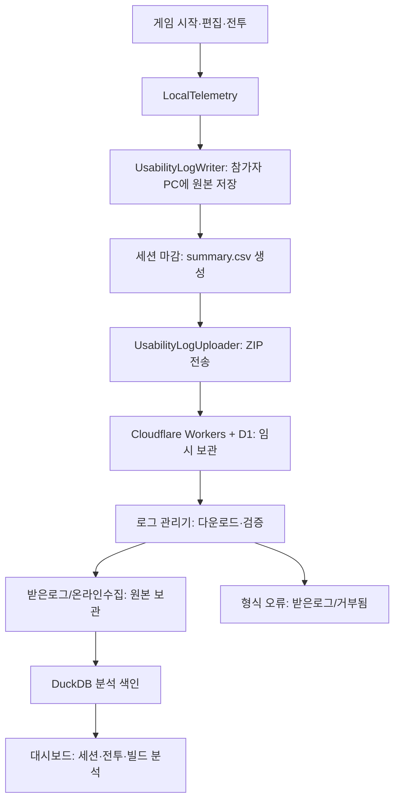

# 로그 시스템 전체 흐름

2026-10-22 운영 변경: 신규 수신 담당은 `C:/Users/JUNGLE/Desktop/로그관리기_신규`다. 기존 `로그관리기`는 과거 자료 열람용으로 자동 수집을 중지했다. 신규 관리기는 과거 원본·DB 없이 시작하며, 게임 전송 주소와 업로드 키는 유지하고 PC 수신 키만 교체했다. 전환 전에 대기하던 1건은 기존 관리기에 보관했다. 같은 주소를 쓰는 이전 게임이 이후 전송한 로그도 신규 관리기로 들어온다. 과거 웹 보고서는 유지하며 신규 관리기의 향후 게시 주소는 별도로 설정했다.

기준일: 2026-10-21. 현재 Unity 프로젝트와 바탕화면 `로그관리기`의 코드를 대조한 설명이다. 게임은 Unity 6000.3.22f1 기준이다. 설정의 실제 주소와 인증 키는 이 문서에 기재하지 않는다.

## 1. 전체 구조



게임이 먼저 로컬 파일을 기록하고, 마감된 세션을 온라인 수집함으로 보낸다. 관리기는 온라인 파일을 내려받아 검증·보관한 뒤 분석한다. 참가자의 게임과 연구자 PC의 분석기는 동시에 켜져 있을 필요가 없다.

## 2. 기록 시작과 종료

- 일반 플레이: 플레이어 빌드에서 일반 시작 시 자동 기록한다. 디버그 시작과 Editor의 일반 시작은 자동 기록 대상에서 제외한다. `PlayerPrefs`에 저장한 임의 ID를 재사용해 참가자를 구분한다. 실명이나 참가자 이름을 자동 수집하는 방식은 아니다.
- 테스트 모드: 입력한 참가자 ID를 사용해 별도 세션을 시작한다. 테스트 시작 상태와 초기 빌드를 기록한다.
- 현재 프로젝트의 조건은 `Develop`, 편집기 모델은 `combined_nodes`다. 일반 플레이와 테스트 여부 등은 공통 메타데이터로 구분한다.
- 세션 시작마다 새 `test_session_id`와 폴더를 생성한다. 기존 세션 파일을 재사용하거나 덮어쓰지 않는다.
- 편집기 진입·종료, 그래프 변경, 빌드 저장, 전투 시작·종료를 각각 연결 ID와 함께 기록한다.
- 정상 마감 시 마지막 그래프, `test_end`, 집계 CSV와 종료 상태를 저장한다. 진행 중 전투가 남아 있으면 `incomplete` 결과로 마감한다.
- 강제 종료 등으로 마감하지 못하면 `session.json`은 `in_progress` 상태일 수 있다. 현재 전송기는 `summary.csv`가 없는 세션을 전송하지 않으므로 이런 세션은 로컬에 남을 수 있다.

주요 구현: [RuneCodeSession.cs](Assets/RuneCode/Session/RuneCodeSession.cs), [LocalTelemetry.cs](Assets/RuneCode/Boot/LocalTelemetry.cs), [RuneCodeApp.cs](Assets/RuneCode/Boot/RuneCodeApp.cs).

## 3. 참가자 PC에 남는 파일

저장 기준은 Unity의 `Application.persistentDataPath`다. Windows에서는 보통 `%USERPROFILE%/AppData/LocalLow/<회사명>/<제품명>`이며 정확한 위치는 빌드의 회사명·제품명 설정에 따라 달라진다.

```text
persistentDataPath/
  UsabilityTests/              플레이어 빌드
    <test_session_id>/
      session.json
      events.jsonl
      combats.csv
      summary.csv             세션 마감 시 생성
      builds/<build_id>.json
      player-session.marker   플레이어 빌드 표시
      upload.receipt          업로드 성공 후 생성
  UsabilityTests_Editor/      Editor 기록, 온라인 전송 제외
```

| 파일 | 역할 |
|---|---|
| `session.json` | 참가자·조건·앱 버전·시작 상태·환경·시작/종료 시각·종료 상태 |
| `events.jsonl` | 한 줄에 이벤트 하나인 원본. 편집·클릭·컴파일·전투·보상 등 |
| `combats.csv` | 전투별 시간, 결과, 피해, 자원, 처치, 인벤토리, 행동별 통계 |
| `summary.csv` | 세션 전체 시간과 이벤트·편집 결과·완료 설계 수 집계 |
| `builds/*.json` | 해당 시점의 그래프 노드·연결·파라미터와 빌드 메타데이터 |
| `player-session.marker` | 전송 대상인 플레이어 빌드 세션임을 표시 |
| `upload.receipt` | 같은 파일 상태의 반복 업로드를 피하는 로컬 전송 기록 |

원본은 UTF-8로 기록한다. 주요 이벤트와 전투 종료에는 즉시 파일 버퍼를 비우고, 일반 기록은 주기 호출에서 약 1초 간격으로 비운다. 업로드 성공 후에도 참가자 PC 원본을 삭제하지 않는다.

별도로 `LocalTelemetry`는 최근 500건의 틱·종류·상세를 메모리 링 버퍼에 유지한다. F8은 이 버퍼를 콘솔에 출력하는 디버깅 기능이다. 세션이 활성화돼 있으면 해당 기록은 `local_telemetry` 이벤트로도 남는다. Unity의 일반 `Editor.log` 전체를 전송하는 구조는 아니다.

## 4. 이벤트 형식과 연결 관계

현재 파일 스키마는 `schema_version = 4`다.

| 필드 | 의미 |
|---|---|
| `participant_id`, `test_session_id` | 참가자와 실행 세션 식별 |
| `app_version`, `condition`, `editor_model` | 앱 버전·실험 조건·편집기 모델 |
| `is_test_mode`, `is_debug`, `is_practice`, `test_order` | 분석 대상 구분용 메타데이터 |
| `event_name`, `event_seq` | 이벤트 종류와 세션 내 증가 순서 |
| `timestamp_utc`, `elapsed_ms` | UTC 실제 시각과 세션 시작 이후 경과 밀리초 |
| `editing_episode_id` | 편집기 이용 구간 |
| `graph_revision_id` | 그래프 변경 버전 |
| `spell_build_id` | `builds/*.json`과 연결할 빌드 ID |
| `combat_id` | 전투 시도 ID. 같은 스테이지 재도전도 구분 |
| `context`, `data` | 발생 화면·맥락과 이벤트별 상세 값 |

주요 이벤트는 `test_start/end`, `editor_enter/exit`, `editor_click`, `editor_action_result`, `compile_result`, `build_snapshot`, `combat_start/end`, `stage_enter`, `spell_complete`, `module_acquired`, `clear_reward_selected` 등이다. 모든 이벤트에 모든 연결 ID가 존재하는 것은 아니다.

캔버스의 `editor_click`은 클릭 직전 히트 판정으로 `node_id`, `rune_id`, `node_category`를 기록한다. `target_kind`는 노드·포트·장착 슬롯·연결선·배경을 구분하며, 슬롯에는 `slot_key`와 `slot_value`도 기록한다. 이 항목을 추가하기 전 빌드는 좌표만 기록할 수 있으므로 대상 미수집과 실제 배경 클릭을 구분해야 한다. 수정 코드를 새로 빌드한 뒤부터 상세 정보가 수집된다.

기록기는 분석기와 의미를 맞추기 위해 일부 입력 필드를 변환한다. 예를 들어 전투의 `duration_ms`는 `seconds`로 단위까지 변환하고, `damage_received`는 `damage_taken`, 컴파일의 `is_valid`는 `ok`로 기록한다. 전투 이벤트의 `kill_count`는 `kills`로 바뀌지만 전투 CSV의 열 이름은 `kill_count`다. 이벤트와 CSV의 열 이름이 모두 같은 것은 아니다.

구현: [UsabilityLogWriter.cs](Assets/RuneCode/Boot/UsabilityLogWriter.cs).

## 5. 전투·룬·모듈 기록

`MissionRun`은 전투 종료·후퇴 시 결과, 스테이지, 전투 시간, 총피해·받은 피해, 에너지, 시전·대시·처치, 보상과 인벤토리를 기록한다.

`SimulationStats`의 `action_stats`는 행동별로 다음 정보를 제공한다.

- 행동 키, 노드 ID, 장착 슬롯, 행동 종류, 속성, 모듈과 부착 노드 ID
- 생성·타격·피해 횟수와 누적 피해
- `direct_damage_by_element`: 실제 속성별 직접 피해
- `status_damage_by_type`: 화상·전격 연쇄 등 상태이상 종류별 피해
- OnHit 발생 수, 후속 생성 수와 연결 대상

빌드 스냅샷에는 룬 ID와 장착 파라미터가 들어간다. 따라서 신규 룬·모듈도 기존 표현을 따르면 원본에 ID로 보존할 수 있다. 분석기의 한글 이름·분류 등록은 별도다. 기존 피해 로그에 없는 상세 정보를 분석기가 소급해서 복원하지는 않는다.

구현: [MissionRun.cs](Assets/RuneCode/Features/Mission/MissionRun.cs), [SimulationStats.cs](Assets/RuneCode/Core/Simulation/SimulationStats.cs).

## 6. 빌드 설정과 자동 전송

`UsabilityLogUploader`는 플레이어 빌드에서만 `StreamingAssets/LogUploadSettings.json`을 읽는다. 활성화 값, 전송 주소와 업로드 키가 유효하면 전송기를 연결한다.

Windows 빌드 후처리의 설정 선택 순서는 다음과 같다.

1. 바탕화면 `PlayLogWorkbench/GameConfig/LogUploadSettings.json`
2. 위 파일이 없으면 프로젝트 `Assets/StreamingAssets/LogUploadSettings.json`

로그 관리기의 현재 폴더 이름은 `로그관리기`지만 후처리의 우선 경로는 여전히 `PlayLogWorkbench`다. 해당 위치에 예전 설정이 남아 있으면 그것이 우선한다. 2026-10-21 확인 당시 우선 경로·프로젝트·현재 관리기 설정은 일치했다.

전송기는 약 15초 간격으로 완료된 로컬 세션을 최신순으로 확인한다. 활성 세션은 제외하고 `summary.csv`와 `player-session.marker`가 있는 폴더만 처리한다. 정상 종료 요청 시에는 세션을 먼저 마감하고 최대 6초 동안 전송을 시도한다. 요청 하나의 제한 시간은 5초이며 실패하면 이후 주기 또는 다음 실행 때 재시도한다.

전송 ZIP에는 `events.jsonl`, `session.json`, `summary.csv`, `combats.csv`, `builds/*.json`만 포함한다. 표시 파일과 수신 기록은 포함하지 않는다. 제한은 세션당 파일 500개, 압축 32MiB, 압축 전 합계 64MiB다. 빌드 스냅샷이 많으면 파일 개수 제한에도 걸릴 수 있다.

요청은 ZIP 본문과 업로드 전용 Bearer 키, `X-PlayLog-Source: player-v1` 헤더를 사용한다. 서버가 HTTP 200을 반환하면 로컬 `upload.receipt`를 저장한다. 이 성공은 온라인 보관 성공을 의미하며 연구자 PC에서 분석을 완료했다는 의미는 아니다.

구현: [UsabilityLogUploader.cs](Assets/RuneCode/Boot/UsabilityLogUploader.cs), [LogUploadBuildProcessor.cs](Assets/RuneCode/Editor/LogUploadBuildProcessor.cs).

## 7. 온라인 수집과 PC 보관

관리기 루트는 이 PC의 `C:/Users/JUNGLE/Desktop/로그관리기`다. 아래 경로는 관리기 루트 기준이다.

1. `cloud/worker.mjs`가 업로드를 받고 Cloudflare D1에 ZIP을 나눠 보관한다. ZIP 해시로 동일 업로드를 구분한다. 코드상 온라인 보관 한도는 384MiB다.
2. 관리기가 실행되면 `app/cloud_sync.py`가 약 30초 간격으로 대기 목록과 ZIP 조각을 가져온다. 게임용 업로드 키와 다른 PC 전용 키를 사용한다.
3. 크기·SHA-256 해시를 확인하고 `app/ingest.py`가 ZIP 경로, 파일 종류, 파일 수, 해제 크기, 이벤트의 세션 식별 정보와 플레이어 환경을 검사한다.
4. 정상 원본은 `받은로그/온라인수집/YYYY-MM-DD/<내용 해시>/`에 저장한다. 같은 내용은 중복 저장하지 않는다. 날짜는 PC 다운로드 날짜가 아니라 최초 온라인 수신 시각의 한국 날짜다.
5. 원본 저장 후 온라인 수신 완료 처리를 요청한다. 서버는 ZIP 조각을 제거하고 중복 방지 수신 기록을 유지한다.
6. 내용 자체가 잘못된 ZIP은 `받은로그/거부됨/YYYY-MM-DD/`에 원본 ZIP과 사유 JSON을 남긴 뒤 온라인 수신 완료 처리한다. 분석에는 넣지 않는다.
7. 실제 저장 드라이브의 여유 공간이 새 파일 크기와 최소 잔여 공간 128MiB의 합보다 작으면 온라인에 남겨 재시도한다. PC 원본의 누적 용량에는 고정 제한이 없다. 이미 보관한 동일 원본은 추가 저장 공간 없이 수신 완료 처리할 수 있다.

연결 상태는 `data/cloud_sync_status.json`에 남는다. PC가 꺼져 있어도 온라인 수집은 가능하지만 실제 서비스 상태·계정 한도에 따라 전송이 보류될 수 있다.

## 8. 분석 색인과 화면

`app/db.py`는 원본 파일을 옮기는 대신 `data/playlog.duckdb`에 분석 색인을 만든다. 기본 입력 우선순위는 다음과 같다.

1. `받은로그/온라인수집`
2. `data/settings.json`의 `sources`에 등록한 외부 폴더
3. 이전 자료인 `data/organized/sessions`

변경된 원본을 다시 읽고 사라진 세션은 색인에서도 제거한다. 같은 내용의 중복 파일은 한 번만 센다. 색인은 원본에서 재구성할 수 있지만 원본 로그는 백업해야 한다.

`app/analysis.py`는 JSONL을 검증·정규화하고 세션, 편집 시간, 클릭, 전투 결과를 집계한다. 다른 모듈이 참가자 진행, 스테이지별 시도·편집 시간, 빌드 그래프, 행동별 피해, 모듈 사용률·픽률·승률 등을 만든다. 빌드는 참가자·세션·빌드 ID로 연결한다.

화면의 날짜·참가자·조건·버전·디버그·연습 관련 필터에 따라 보이는 분석 대상이 달라진다. 새 로그가 파일에 존재해도 선택한 수집 날짜 밖이면 화면에 나오지 않을 수 있다. 폴더 직접 지정 모드는 색인 대신 해당 폴더의 원본을 읽는다.

## 9. 현재 호환성과 확장 시 확인할 곳

2026-10-21 코드 비교에서 기본 스키마·빌드 표현·속성별 및 상태이상별 피해 입력 구조는 서로 대응했다. 다만 관리기 `app/module_catalog.json`에 다음 항목이 없었다.

| ID | 게임 이름 | 분석기에 미치는 영향 |
|---|---|---|
| `behavior.slash` | 참격 | 이름·분류 누락 |
| `form.slash` | 참격 수치 | 내부 항목 등록 누락 |
| `mod.saving` | 절약 | 이름·분류 누락 |
| `mod.beamEmpower` | 과충전 | 이름·분류 누락 |

관리기 `app/action_combat.py`의 행동 이름 매핑에도 `slash`가 없어 그대로 표시된다. 이는 확인된 해석·표시 누락이다. 신규 항목의 실제 최신 빌드 로그를 생성해 끝까지 수신·분석하는 검증은 별도로 필요하다.

룬을 추가할 때는 관리기의 이름·분류 카탈로그, 행동 표시 매핑을 함께 확인한다. 장착 슬롯 표현, 이벤트 이름, ID 연결 방식, 필드 의미·단위를 바꿀 때는 해당 파서와 집계도 맞춰야 한다. 이전 로그의 이름·분류를 유지해야 하므로 더 이상 쓰지 않는 카탈로그 항목을 일괄 삭제하지 않는다.

## 10. 문제를 찾는 순서

| 증상 | 먼저 확인할 곳 |
|---|---|
| 로컬 세션 폴더가 없음 | 일반/테스트 시작 여부, Editor·디버그 여부, `persistentDataPath` |
| 폴더는 있지만 전송 안 됨 | `summary.csv`, `player-session.marker`, 빌드 안 전송 설정, Unity 경고 |
| 온라인에는 있지만 PC에 없음 | 관리기 실행 여부, 수집 상태, 디스크·보관 한도, 거부 폴더 |
| 받은 파일이 화면에 없음 | 선택 날짜와 필터, 색인 상태, 원본 경로 유지 여부 |
| 룬이 내부 ID·미등록으로 보임 | `app/module_catalog.json`과 행동 이름 매핑 |
| 빌드가 연결되지 않음 | 참가자·세션·빌드 ID 일치, `builds/*.json` 존재 여부 |
| 강제 종료한 플레이가 안 올라옴 | 마감 여부. 현재 전송기는 미마감 세션을 자동 복구·전송하지 않음 |

## 관련 문서와 검증 범위

- 게임 구조의 로그 개요: [06_Flows_and_Extension.md](Assets/Docs/06_Flows_and_Extension.md)
- 관리기 운영·설치·수집 안내: [README_온라인수집.md](../../Desktop/로그관리기/README_온라인수집.md)
- 관리기 분석 기능 안내: [README.md](../../Desktop/로그관리기/README.md)

이 문서는 로컬 코드를 기준으로 작성했다. 앞선 호환성 점검에서 관련 기존 분석 검증 35개가 통과했다. 전체 화면 검증과 현재 Unity 빌드의 로그 생성 → 업로드 → 다운로드 → 분석 실동작은 완료하지 않았다. 서비스의 현재 연결 상태와 배포된 서버 코드까지 일치하는지는 별도 확인 대상이다.


## 11. 라운드 후 작업실 플레이테스트 로그 (2026-10-22)

신규 관리기 `C:/Users/JUNGLE/Desktop/로그관리기_신규`와 신규 홈페이지에만 적용한다. 홈페이지 주소는 https://playlog-report-new-20261022.playlog-cloud-collection.workers.dev/ 이다. 기존 관리기의 기록과 홈페이지는 유지한다.

- `editor_enter`·`editor_exit`: 기존 `editing_episode_id`로 방문을 묶고 stage, round, entry_reason, inventory, skill_tree, comparison_key, node_count, edge_count를 기록한다. 라운드 후 복귀는 entry_reason=round_break이며 일반 진입과 구분한다.
- inventory에는 보유 룬 종류·등급·총수량, 해금 목록, 재화가 포함된다. 장착 수량이나 미사용 수량을 뜻하지 않는다.
- `workshop_tab_switch`: from_tab, to_tab을 기록한다. 같은 탭 재선택은 전환으로 세지 않는다.
- `upgrade_purchase`: 성공한 구매의 node_id, level_before/after, cost, currency_before/after, 적용 skill_tree를 기록한다.
- `rune_synthesis`: materials, material_grade, 성공/거절, 결과 rune_id·grade, 오류, currency_before/after, 합성 후 inventory를 기록한다. 합성 규칙·비용·저장 실패 복구는 기존과 같다.
- 정상 세션 종료에서는 열린 방문을 먼저 마감한다. 프로세스 충돌·전원 종료처럼 종료 기록이 없으면 분석기는 퇴장 미기록으로 표시하며 체류 시간을 만들지 않는다.
- 입장·퇴장과 구매·합성은 즉시 로컬 파일로 flush한다. 업로드 정책은 기존 세션 마감 후 전송을 유지한다.

신규 DB 색인 버전은 4이다. editing_episode_id, graph_revision_id, stage, round 열을 추가하며 기존 압축 원본과 원본 파일에서 색인을 재구성한다. 실제 이벤트의 중첩 상태와 재료 목록은 원본 JSONL에 보존한다.

신규 로컬 분석기와 웹의 ‘작업실 방문’ 화면에서 라운드별 방문 여부, 방문 횟수, 체류 중앙값, 빌드 변경 없음 비율, 퇴장 누락, 클리어 후 입장 지연, 탭별 관측 체류, 행동 순서, 보유 룬 수량 변화, 입장·퇴장 강화 상태를 확인한다. 방문율의 분모는 round_break_start와 round_break_end가 모두 관측된 휴식 구간이며, 빌드 변경 없음 비율은 양쪽 비교키가 있는 방문만 사용한다. 체류는 일시정지 등을 포함한 실제 경과 시간이다. 빌드 비교는 이름·좌표·노드 ID 차이를 제외하는 기존 비교키를 사용한다.

웹에는 방문 집계와 필요한 상태·행동 결과만 게시한다. 새 로그는 PC에서 수집·분석한 뒤 웹 보고서를 다시 게시해야 반영된다. 이전 빌드의 누락 정보를 복구하지 않으며 상세 로그는 새 게임 빌드부터 생성된다. 테스트 모드에서는 기존 규칙상 합성이 비활성화되므로 합성 플레이테스트는 일반 플레이 빌드로 진행한다.

검증: 기존 Unity 프로젝트 참조로 C# 직접 컴파일 통과(기존 Inspector 필드 경고 존재), Python·JavaScript 구문 확인, 메모리 자료로 정상/누락 방문 경계·라운드 미방문·탭 체류·구매/합성·룬 수량 변화·DB 신규 열 적재 확인. Unity Editor 실제 플레이, 새 실행 파일 빌드, 실게임 로그 생성→수신 전체 흐름은 미검증이다. Inspector 추가 작업은 없다.


## 12. 적 유형별 피해·생존시간과 상세 로그 정리 (2026-10-22)

게임의 기존 SimulationStats에서 적 개체별 누계를 관리한다. 생성 시 고유 개체 ID, 유형 ID, 스테이지, 라운드, 엘리트 여부, 생성 전투 시간을 저장한다. 실제 피해 적용 직후 HP 감소량과 보호막 흡수량을 기록하며 무적으로 막힌 공격과 초과 피해는 합산하지 않는다. 유효 피격은 HP 또는 보호막이 실제로 감소한 피해 적용 횟수다.

접촉·일반 탄환·저격·보스 장판·자폭·히드라 공격을 원래 공격한 적에게 귀속한다. 탄환에는 원래 적 ID를 보관하므로 발사자가 죽은 뒤 맞아도 해당 유형의 피해로 집계된다. 플레이어 자체 상태 이상은 player_status, 출처를 확인하지 못한 피해는 unknown으로 분리하며 적의 생성·생존시간 표본에 포함하지 않는다. 유형별 스테이지는 해당 적이 생성된 스테이지다. 라운드 전환 시 적 탄환은 기존 규칙에 따라 정리된다.

생존시간은 생성~사망의 시뮬레이션 전투 초다. 작업실·일시정지 시간은 시뮬레이션이 진행되지 않아 포함하지 않는다. 살아 있는 채 보스 웨이브 종료로 제거된 적은 wave_ended_alive로 구분한다. 사망하지 않았거나 사망을 관측하지 못한 개체에는 lifetime_seconds를 만들지 않으며, 관측된 생존 경과 시간만 별도로 제공한다. 평균·중앙 생존시간과 표본 수는 사망 기록이 있는 개체만 사용한다.

라운드의 round_break_start와 최종 combat_end 이벤트의 data.enemy_stats에 개체별 변경 누계 및 생존 중인 개체의 관측 상태를 기록한다. 정상 타이틀 복귀·앱 종료로 전투가 incomplete 마감되는 경우에도 등록한 스냅샷 공급자로 마지막 누계를 수집한다. 매 타격마다 파일에 쓰지 않는다. 같은 세션·전투·개체의 누계는 최신 값으로 갱신하므로 라운드 기록과 최종 기록을 중복 합산하지 않는다. 마지막 라운드 이후 변경이 없는 사망 개체는 재전송하지 않는다. 강제 종료 등으로 마감 로그가 없으면 마지막으로 남은 관측분만 확인할 수 있다.

신규 DB 버전 4의 enemy_observations 표에 개체 ID·적 유형·스테이지·라운드·시간·피해·피격 누계의 관측 행을 색인한다. 원본 이벤트는 기존 압축 sources에도 보존하며 원본 파일에서 색인을 재구성할 수 있다. 신규 분석기의 enemy_analysis.py와 신규 홈페이지 ‘적 유형 분석’ 탭에서 전체/스테이지별 비교, HP 피해·보호막 흡수·유효 피격, 적 생성·사망·생존 관측 수, 적당 HP 피해, 피해 비중, 평균·중앙 생존시간과 개체별 상세를 제공한다. 과거 로그의 적별 피해를 처치 수로 추측해 채우지 않는다.

중복 local_telemetry 세부 종류 mission.node, dock.node, bench.cast, mission.start, mission.result, upgradeTree.purchase의 세션 파일 기록을 중단했다. 기존 500건 메모리 링 버퍼와 구조화된 시전·전투·강화 기록은 유지한다.

검증: Core와 Assembly-CSharp를 기존 Unity 참조로 직접 컴파일 통과. C# 누계 객체 실행으로 생성·생존 관측·사망시간·변경분 중복 억제·사망 후 피해 갱신을 확인했다. 메모리 JSONL로 최신 누계 병합, 전투별 ID 구분, 전체/스테이지별 합계, 미관측 생존시간 제외, 중앙값과 DB 관측 행 적재를 확인했다. 웹은 메모리 DOM으로 전체/스테이지 전환과 상세 렌더링을 확인했다. 신규 홈페이지 게시와 신규 분석기 재시작을 진행했다. Unity Editor 실제 플레이·Player 빌드·실제 공격별 수신 전체 흐름은 미검증이다. 별도 Inspector 연결은 없다.


## 13. 2026-10-22 플레이어 로그 마감 오류 수정

Player.log에서 Unknown combat column: enemy_stats 예외를 확인했다. 적 통계 공급자가 combat_end에 추가한 enemy_stats와 미션 종료 누계 active_seconds가 고정 CSV 열 목록에 없었다. 두 열을 등록해 JSONL과 CSV의 입력 계약을 일치시켰다. 이전 빌드는 CSV 기록 직전 예외로 combat_id를 해제하지 못하고 test_end·summary.csv를 만들지 못했으며, 완료 세션만 보내는 업로더가 해당 폴더를 전송하지 않았다. 종료 재시도에 따른 반복 combat_end는 별개의 전투가 아니다.

해당 실제 플레이 원본(events.jsonl 275건·빌드 5개)은 변경하지 않고 신규 관리기의 2026-10-22 수집 폴더로 복사·색인했다. test_end·summary.csv를 임의 생성하지 않았으며 부분 세션으로 해석해야 한다. 원본 플레이어 폴더는 보존했다. 검증: Core·게임 코드 컴파일 통과, 수정된 실제 기록기를 사용해 combat_end → CSV → test_end → summary.csv → ended 마감 경로 통과. 기존 Player 실행 파일에는 수정이 반영되지 않으므로 재빌드가 필요하다. 수정한 Player 빌드의 실제 업로드까지는 아직 미검증이다.


## 14. 보스 패턴별 사용·피해 (2026-10-23)

히드라·레골라스·헥사·거버너·미니 거버너에 패턴 시작 횟수와 실제 HP 피해·보호막 흡수·유효 피격 누계를 추가했다. 기존 round_break_start / combat_end의 data.enemy_stats에서 보스 행의 boss_patterns 배열로 전송한다. 각 항목은 enemy_id, stage, round, pattern, use_count, damage_hp, shield_absorbed, hit_count다. 기존 enemy_stats CSV 열과 종료 스냅샷 공급자를 재사용해 별도 CSV 열은 추가하지 않는다.

발사한 탄환·예약 연사는 생성 때 패턴 ID를 보관하므로 이후 패턴 변경이나 보스 사망으로 출처가 바뀌지 않는다. 히드라 독·파동과 레골라스 범위 공격도 생성 패턴을 유지한다. 헥사 소환물과 거버너 증원의 피해는 적 유형 통계에서는 원래 적에게, 보스 패턴 통계에서는 소환 보스의 summon / reinforcement에 기록한다. 두 표의 피해를 다시 더하면 중복이다. 접촉은 contact로 구분하며 사용 횟수는 0이다. 사용 횟수는 공격 시작 횟수이고 명중 수나 탄환 수가 아니다. 피해의 stage/round는 실제 피해 적용 시점이다.

세션·전투·보스 개체·스테이지·라운드·패턴별 마지막 누계로 해석해야 중복 스냅샷을 더하지 않는다. 원본 JSON을 보존하는 기존 DB 경로를 사용하므로 별도 DB 표·스키마 변경은 없다. 이번 작업은 게임 로그 수집만 추가하며 분석기 화면·웹 게시를 변경하지 않는다. 새 Player 빌드부터 수집 가능하며 과거 로그는 복원하지 않는다. 사용자 요청에 따라 추가 검증은 진행하지 않는다. 상세 범위는 Assets/Share Docs~/PRD_BossPatternLogs.md를 참고한다.
